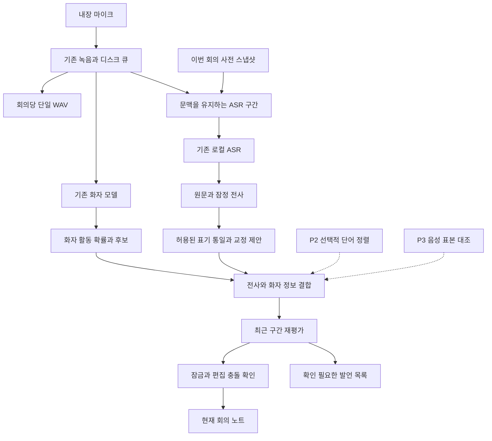

# 노트북 로컬 회의록 사전과 화자 인식 개선 설계서

작성일: 2026년 10월 27일 · 기준 구현: 0.4.0 · 문서 버전: 1.0 · 상태: 설계 기준선 · 최신 구현과 검증은 STATUS.ko.md 참조

Apple M4와 통합 메모리 24GB를 사용하는 현재 노트북에서, 외장 마이크 없이 전사와 화자 구분을 개선한다. 먼저 기존 모델의 입력과 결과 연결을 개선하고 업무 용어 사전을 연결한다. 단어 정렬과 참여자별 음성 특징 대조는 품질과 자원 검증을 통과한 뒤 추가한다. 구현 순서와 통과 조건을 정의한 문서이며 코드 작성·모델 설치·재전사·앱 설정 변경은 포함하지 않는다.

이 문서는 기존 PLAN.ko.md의 품질 개선 부분을 구체화한다. 기존 문서의 초기 장비·실행 수치와 이 설계의 기준 구현 상태가 충돌하면 최신 STATUS.ko.md와 실제 설치본을 따른다. 달력·요약 기능의 기존 범위는 이 문서에서 변경하지 않는다.

## 1 목표와 고정 조건

### 1.1 제품 목표

- 기술 용어·기관명·인명·약어를 반복해서 수정하는 부담을 줄인다.
- 짧은 맞장구를 보존하고, 화자 경계의 흔들림을 실제 동시 발언과 구분한다.
- 이름 등록, 익명 화자 구분, 음성 표본 등록의 차이를 사용자가 알 수 있게 한다.
- 불확실한 발언을 특정 사람에게 강제로 배정하지 않는다.
- STT가 동작하는 동안 같은 노트에 필기하고 한글을 조합할 수 있다.

### 1.2 유지할 동작

| 항목 | 결정 |
| --- | --- |
| 실행 환경 | 현재 Mac의 Obsidian 데스크톱과 로컬 Python·네이티브 워커 |
| 추론 | 외부 API·원격 폴백 없음. 회의 실행 중 다운로드 없음 |
| ASR 기준 | 설치된 한국어 미세조정 Qwen3-ASR-1.7B MLX 8비트 |
| 화자 기준 | 설치된 Nemotron 3 Diarization GGUF와 C ABI |
| 오디오 | 시작부터 종료까지 회의당 recording.wav 하나, PCM 디스크 큐 유지 |
| 본문 | 일반 텍스트 `화자 이름: 대사`. 내부 ID·확률·JSON·HTML 주석을 본문에 넣지 않음 |
| 문단 | 같은 화자는 이어 쓰고 기본 2.5초 이상 휴지에서 새 문단. 사용자 필기 경계를 넘겨 결합하지 않음 |
| 시간 | 현재 시간 표시 켜기·끄기와 단축키 유지 |
| UI | 이동 가능한 오버레이와 상세 사이드바 유지 |
| 보존 | 사용자 수정·삭제·선택 영역·커서·IME·실행 취소 동작 보호 |

현재 드라이버에서 내장 마이크는 입력 1채널로 제공되며 원본도 모노다. 발언 방향 추정, 좌석 방향을 이용한 자동 배정, 다채널 녹음은 이번 설계 범위에서 제외한다. 음량·음높이만으로 사람을 식별하는 규칙도 사용하지 않는다.

### 1.3 관측과 판단의 구분

오늘 회의의 저장된 전사 498구간 중 181개가 1초 미만이다. 동시 발언으로 저장된 87구간 중 80개도 1초 미만이다. 이는 현재 파이프라인이 짧은 구간을 많이 다룬다는 증거이며, 오인식률이나 실제 동시 발언 비율은 아니다. 현재 오류율과 개선 목표 달성 여부는 사람이 확인한 음성과 정답 라벨로 판단한다.

이후 표의 기본값·시간·목표 수치는 모두 개발 착수 시 비교할 초기 설계값이다. 구현·실측·달성된 성능 수치로 제시하지 않는다.

## 2 우선순위와 개발 단위

| 순서 | 개발 단위 | 먼저 하는 이유 | 추가 모델 | 의존성과 완료 조건 |
| --- | --- | --- | --- | --- |
| P0 | 평가 기준·진단·수정 보호·변경 이력 | 무엇이 좋아졌는지 판단하고 사용자 노트를 보호할 기반 | 없음 | 동일 오디오 재생 평가, 잠금·삭제·복구·이벤트 재전달 검사 통과 |
| P1A | 회의 사전과 제한된 표기 통일 | 반복되는 업무 용어 오류에 직접 대응하며 기존 context 입력 활용 가능 | 없음 | P0. 사전 켜기·끄기 비교와 원문 보존 통과 |
| P1B | ASR 구간 개선과 화자 후보 보존 | 짧게 자른 독립 전사와 overlap 정보 소실 개선 | 없음 | P0. P1A를 켜고 끈 상태에서 각각 검증 |
| P1C | 잠정 결과 재평가와 교정 검토 화면 | 최근 화자 경계 개선을 반영하되 잘못된 확정을 줄임 | 없음 | P1B와 개정 번호·잠금 처리. 사용자 필기 회귀 없음 |
| P2 | 선택적 단어 시간 정렬 | 여러 사람이 포함된 문맥 전사에서 단어별 귀속 근거 확보 | ForcedAligner 후보 | P1 전체. 한국어·M4 호환성과 부하·정렬 실패 처리 검증 |
| P3 | 참여자별 음성 표본 대조 | 비슷한 음색·톤 변화·익명 화자 혼동에 추가 근거 제공 | 음성 특징 모델 후보 | P0와 P1. 등록하지 않은 사람·불확실 결과를 포함한 평가 통과 |

첫 개선판의 범위는 P0와 P1이다. P2·P3는 외장 마이크 없이 실행할 수 있지만 추가 모델이 필요하므로 첫 개선판의 전제 조건으로 삼지 않는다. P1A와 P1B는 효과를 분리해서 측정한 뒤 함께 평가한다. 정확도가 확인되기 전에 양자화 정밀도나 ASR 모델까지 동시에 바꾸지 않는다.

## 3 전체 처리 구조



녹음 콜백은 모델·사전·노트 처리를 기다리지 않는다. 화자 모델에는 원본 시간 순서대로 각 샘플을 한 번만 공급한다. ASR용 중첩 입력을 화자 모델에 다시 넣어 시간축을 늘리지 않는다. ASR 구간은 기존 PCM 큐 경계와 독립적으로 원본 샘플 범위를 참조한다.

## 4 사전 기능

### 4.1 사전의 범위와 우선순위

이번 회의 → 명시적으로 선택한 프로젝트 → Vault 공통 → 개인 기기 순으로 적용한다. 동일 항목을 합칠 때는 상위 범위의 명시적 설정이 우선한다. 상위 범위에서 비활성화한 항목이 하위 범위에서 되살아나지 않도록 제외 목록도 저장한다.

프로젝트는 현재 노트 폴더에서 추천할 수 있지만 자동 선택으로 확정하지 않는다. 첫 사용은 사전이 비어 있어도 녹음 가능하다. 회의 시작에 활성 사전의 버전과 항목을 스냅샷으로 고정한다.

| 데이터 | 기본 위치와 동기화 |
| --- | --- |
| 개인 사전 | Vault 밖 로컬 앱 데이터. 자동 동기화하지 않음 |
| Vault·프로젝트 사전 | 기본은 Vault 밖 로컬 저장. 사용자가 내보내거나 Vault 저장을 선택할 수 있음 |
| 회의 사전 스냅샷 | 기존 회의 저장 폴더. 회의 재현과 해당 범위 재처리에 사용 |
| 음성 표본·특징 | 사전과 분리하여 Vault 밖 로컬 보관. 텍스트 사전 내보내기에 포함하지 않음 |

로컬 기본 경로는 기존 오디오 저장 루트 아래 `.local-meeting-quality/<vaultId>/`로 제안한다. Vault·프로젝트 사전은 `dictionaries.sqlite`, 프로젝트 목록은 같은 DB의 별도 테이블, 음성 특징은 `voice-profiles/`에 둔다. 여러 Vault에서 공통으로 쓰는 개인 사전은 `.local-meeting-quality/personal/dictionaries.sqlite`에 분리한다. 회의 폴더에는 `dictionary-snapshot.json`과 실제 사용한 버전만 저장한다. UUID로 구분하는 기존 회의 폴더와 공유 설정을 혼동하지 않게 한다. Vault에 내보내면 해당 Vault의 동기화 대상이 될 수 있음을 저장 위치 선택 화면에 표시한다.

### 4.2 항목 스키마

아래는 데이터 계약 예시이며 실제 코드가 아니다.

```json
{
  "schemaVersion": 1,
  "id": "term_uuid",
  "canonical": "OpenSearch",
  "pronunciations": ["오픈 서치"],
  "observedErrors": ["오픈소치"],
  "category": "technical",
  "scope": {"kind": "project", "id": "project_uuid"},
  "contextTags": ["검색", "DB"],
  "recognitionHint": true,
  "postprocess": "suggest",
  "confirmedByUser": true,
  "enabled": true,
  "revision": 1
}
```

종류는 기술 용어·기관·제품·인명·약어·기타로 구분한다. `pronunciations`는 발음·별칭이고 `observedErrors`는 확인된 과거 오인식이다. 오인식 형태를 ASR 문맥에 그대로 주입하지 않는다. 항목에는 생성·수정 시각과 작성 출처를 저장하되 전체 회의 문장을 사전 항목에 복사하지 않는다.

기본 입력 제한은 표준 표기 80자, 별칭과 오인식 각각 최대 10개, 설명 200자다. 줄바꿈·제어문자·경로·프롬프트 명령 형식은 거부하고 NFC 유니코드로 정규화한다. 사용자가 일반 문장을 사전에 넣어 ASR 출력 지시로 사용하는 기능은 제공하지 않는다.

### 4.3 ASR 전에 적용하는 인식 문맥

설치된 `Session.transcribe`의 `context`에 관련 표준 용어와 확인된 발음 별칭을 간결하게 전달한다. 사전 전체를 문자열 치환 규칙처럼 전달하지 않는다. 초기 선택 상한은 40개 용어, 토크나이저 기준 총 256토큰이며 먼저 도달한 제한을 따른다. 비교 실험은 20·40·80개를 사용하되 전체 토큰 제한을 함께 기록한다.

선택 순서는 이번 회의에서 고정한 항목, 프로젝트 항목, 현재 문맥과 관련된 공통 항목이다. 자동 전사에 한 번 나타났다는 이유만으로 사전 항목을 만들거나 우선순위를 높이지 않는다. 과거 오인식이 스스로 강화되는 경로를 막는다.

참여자 이름은 사용자가 선택하면 인명 용어로 포함한다. 이는 대사 속 이름 인식을 돕는 기능이며, 그 목소리의 주인을 확인하는 기능이 아니다.

### 4.4 ASR 이후 적용 정책

| 정책 | 동작 | 기본값 |
| --- | --- | --- |
| 인식 힌트만 | ASR 문맥에만 사용하고 결과를 치환하지 않음 | 인명·기관·신규 항목 |
| 표기 통일 | 확인된 발음 표기를 표준 표기로 변환 | 사용자가 항목별로 허용한 경우 |
| 교정 제안 | 원문을 유지하고 차이와 후보를 검토 화면에 표시 | 과거 오인식 형태 |
| 비활성 | 이번 회의 또는 전체에서 제외 | 명시적 제외 시 |

표기 통일은 확정된 별칭의 가장 긴 일치를 먼저 적용하고 한 번의 변환만 허용한다. A→B→C 연쇄 치환은 금지한다. 한국어 조사 결합은 허용된 형태만 처리하며 광범위한 부분 문자열 치환은 하지 않는다. 같은 별칭이 두 항목에 대응하면 충돌로 표시하고 자동 통일을 중단한다.

숫자·부정 표현·조건문·담당자·기한은 사전 기능으로 추정하지 않는다. 예를 들어 `키스`를 항상 `TS`로 바꾸지 않는다. 표기 통일도 원문과 적용 항목 ID를 보존하므로 취소할 수 있다. ASR 결과에 없는 용어가 힌트 때문에 삽입되는 현상은 평가 항목에 포함한다.

### 4.5 사용자 흐름

1. 상세 화면의 `회의 사전`에서 프로젝트와 활성 용어 수를 확인한다.
2. `용어 추가`에서 표준 표기·발음·종류·적용 범위·정책을 지정한다. 기본 정책은 인식 힌트만이다.
3. 전사된 단어를 고친 경우 명시적 명령 `선택한 표현을 사전에 추가`를 제공한다. 수정할 때마다 팝업을 띄우지 않는다.
4. `오픈소치 → OpenSearch`처럼 원문과 교정어가 확인된 경우에만 두 항목을 미리 채운다. 자유 필기 수정은 자동 수집하지 않는다.
5. 회의 중 변경한 사전은 `이후 발언부터 적용`한다. 과거 내용 적용은 구간과 차이를 보여 준 뒤 사용자가 별도로 실행한다.
6. 내보내기는 버전이 포함된 JSON과 사람이 읽는 CSV를 제공하는 설계로 둔다. 가져오기는 미리보기·중복·충돌 검사를 거치며 자동으로 기존 항목을 덮어쓰지 않는다.

사전을 켜고 끄는 명령은 명령 팔레트에 등록하되 새 기본 단축키는 지정하지 않는다. 기존 Obsidian 단축키와의 충돌을 피하고 사용자가 배정할 수 있게 한다.

## 5 ASR 입력과 잠정 전사

### 5.1 서로 다른 시간 기준

| 기준 | 초기값 | 역할 |
| --- | --- | --- |
| 원본 저장·PCM 큐 | 현재 녹음 경로 유지 | 모델 처리 속도와 독립적인 원본 보존 |
| ASR 문맥 창 | 기본 10초, 최대 15초 | 단어와 문장 앞뒤 음성 유지 |
| 잠정 전사 요청 | 새로운 음성 약 3초마다, 최소 발화 관측 약 2초 | 회의 중 본문 입력 제공 |
| 발화 종료 판단 | 비발화 약 0.7초를 초기 비교값으로 사용 | 말끝이 나타났을 때 확정 후보 생성 |
| 문맥 창 경계 중첩 | 0.8초 | 앞뒤 경계에서 잘린 단어 재검토 |
| 자동 재평가 범위 | 최근 최대 10초 | 최근 잠정 텍스트·화자 재평가 |
| 본문 새 문단 | 기존 기본 2.5초 | 표시와 필기 편의. 위 모델 기준과 독립 |

3초 요청 주기는 3초 이내 결과 보장이 아니다. 실제 지연은 입력 관측·큐 대기·추론·재평가·IME 대기 시간을 더해 측정한다. 긴 문맥을 매번 다시 읽으면 추론 비용이 늘므로 전체 ASR 처리량을 반드시 함께 측정한다.

### 5.2 구간 생성과 보존

시작·끝의 기준은 16kHz 원본의 샘플 인덱스다. 밀리초와 UI 시간은 여기에서 계산한다. 디스크 작업 ID를 전사 발언 ID로 사용하지 않는다. 한 PCM 작업에서 여러 발언이 나오거나 여러 작업을 합쳐 하나의 입력을 만들 수 있다.

화자 모델의 작은 경계 변화마다 ASR 작업을 만들지 않는다. 비발화 판단에는 전체 화자 활동과 음성 크기를 함께 참고하되 작은 음량만으로 발화를 버리지 않는다. 원본·시간 범위는 비발화 후보에서도 보존한다. 기존 모델의 활동 판정으로 누락이 확인되면 별도 로컬 VAD 비교를 검토하며 첫 단계에서 자동 도입하지 않는다.

긴 동일 화자 발언은 문맥 창 안에서 전사한다. 안정적인 화자 전환이나 말끝에서 구간을 마감한다. 1초 미만 응답은 주변 문맥을 포함한 전사 후보로 다루며 삭제하거나 앞 화자와 합치지 않는다. 다만 정렬 정보 없이 앞뒤 문맥까지 포함해 인식한 문자열을 모두 짧은 응답자의 말로 붙이지 않는다.

### 5.3 잠정 결과와 확정

텍스트 상태와 화자 상태는 독립적이다. 글자가 안정됐어도 화자는 미확정일 수 있다. 직전 두 번의 문맥 전사에서 일치한 문자열과 말끝 정보를 이용해 텍스트 확정 후보를 만든다. 문맥 창이 이동할 때는 공통 음성 구간을 기준으로 비교하고, 반복된 문장을 문자열이 같다는 이유만으로 지우지 않는다.

P1에서는 단어 시간이 없으므로, 안정적인 단일 화자 구간과 텍스트의 대응이 명확할 때만 자동 귀속한다. 여러 화자가 포함됐는데 어느 단어가 누구 말인지 모르면 본문은 `화자 미확정: 대사`로 유지하고 상세 화면에 후보를 표시한다. 추정 글자 수에 비례해 발언을 잘라 여러 사람에게 나누지 않는다.

P2의 단어 정렬이 통과하면 해당 단어 범위의 활동 정보를 이용해 더 세밀하게 귀속한다. 강제 정렬은 잘못 인식한 텍스트를 정답으로 고치지 못하므로 반복·누락·큰 시간 오차를 감지하면 정렬을 불확실로 처리한다.

### 5.4 부하 제어

오디오 저장을 최우선으로 유지하고 ASR 추론은 한 번에 하나만 실행한다. 선택 기능의 우선순위는 실시간 ASR·화자 처리, 경계 재평가, P3 특징 대조, 종료 후 보정 순이다. 재평가 요청은 같은 범위의 가장 최신 요청으로 합칠 수 있지만 원본 음성과 아직 처리하지 않은 필수 범위는 버리지 않는다.

미처리 원본 범위가 10초를 넘는 상태가 15초 지속되면 잠정 전사 주기를 3→5초로 늘리고 중복 재평가와 특징 대조를 보류한다. 5초 미만 상태가 30초 지속되면 복귀한다. 이는 초기 제어값이다. 모델이나 정밀도를 사용자 모르게 변경하지 않는다. 원본 기준 처리 범위가 빠짐없이 남도록 실행 목록과 커밋된 범위를 저장한다.

현재 `lag`는 끝-시작 범위라 무음까지 포함하며 실제 추론량과 다를 수 있다. `pendingAudioSeconds`, `oldestUnprocessedAge`, `optionalRefinementPending`, `captureCommittedSample`, `transcriptCommittedSample`을 나눠 표시한다. 모델이 입력을 지속적으로 따라가지 못하면 큐가 누적된다는 사실을 숨기지 않는다.

### 5.5 입력 품질과 전처리

실제 사용 장치 이름·샘플레이트·채널 수를 시작 화면에 표시한다. 시작 전 선택적으로 약 10초의 발언을 확인하고, 녹음 중에는 최근 발화 크기·배경 크기 추정·클리핑·장치 데이터 손실을 상세 화면에 표시한다. 단순 전체 RMS나 볼륨 하나를 신호 대 잡음비라고 표기하지 않는다.

강한 잡음 제거·자동 게인·음성 향상 모델은 기본 경로에 넣지 않는다. 이런 처리가 음색과 작은 맞장구를 바꿔 화자 판정에 영향을 줄 수 있기 때문이다. 우선 원본 입력을 기준으로 평가하고, 전처리 비교가 필요하면 ASR용 파생 입력에만 적용해 원본 WAV와 화자 모델의 입력을 보존한다. 소프트웨어로 크기를 키우면 잡음도 함께 커지므로 작은 음성을 자동으로 증폭하는 것만으로 품질 향상을 주장하지 않는다.

## 6 추가 모델 없이 수행하는 화자 개선

### 6.1 활동 확률을 직접 보존

현재 C ABI의 `nemo_speech_diar_frame_probs_start`, `nemo_speech_diar_frame_probs`, `nemo_speech_diar_seconds_per_frame`, `nemo_speech_diar_num_speakers`를 연결할 설계다. 출력 주기를 10ms로 하드코딩하지 않고 실행기 조회값을 사용한다. 프레임 시작 오프셋도 보존하여 장시간 스트림의 내부 압축 이후에 시간이 밀리지 않게 한다.

활동 확률은 각 화자가 그 시간에 말하고 있는지의 점수다. 여러 사람이 동시에 높을 수 있으며 실제 인물의 신원 확률이나 합계 1인 분류 확률로 사용하지 않는다. 확률·분할 파라미터·모델 버전을 기록하고 최근 프레임은 수정 가능하게 둔다.

### 6.2 비교할 후처리 초기값

| 파라미터 | 초기 후보 | 비교 범위 |
| --- | --- | --- |
| 발화 시작 onset | 0.60 | 0.50 / 0.60 / 0.70 |
| 발화 종료 offset | 0.40 | 0.30 / 0.40 / 0.50, onset보다 낮게 유지 |
| 경계 완충 | 앞뒤 각각 0.08초 | 0 / 0.08 / 0.16초 |
| 동일 화자의 작은 공백 연결 | 0.12초 | 0.08 / 0.12 / 0.20초 |
| 동시 활성 지속 관측 | 0.20초 | 0.10 / 0.20 / 0.30초 |
| 화자 전환 안정화 관측 | 0.20초 | 0.10 / 0.20 / 0.30초 |

이는 튜닝 후보이며 제품 확정 임계값이 아니다. 모든 조합을 탐색하지 않고 한 항목씩 바꾸어 영향을 분리한다. 라이브러리에서 0이 기본값 유지로 해석되는 설정은 별도 후처리에서 0초 조건을 비교해야 한다.

짧은 구간 필터는 발언 삭제 규칙으로 쓰지 않는다. 0.20초보다 짧은 실제 “네”도 있을 수 있으므로 약한 구간은 `확인 필요`로 남긴다. 패딩 때문에 두 구간이 겹친 것만으로 동시 발언을 확정하지 않는다. 실제 동시 활성 판단과 ASR 문맥 확장용 패딩은 구별한다.

### 6.3 화자 판정 규칙

| 관측 | 판정 |
| --- | --- |
| 충분한 발화 범위에서 한 후보만 안정적 | 익명 화자 후보 배정. 이름 연결이 있으면 해당 이름 표시 |
| 두 후보가 실제로 동시 활성 | 후보 ID 집합 보존, overlap 상태. 한 명의 대사로 강제 확정하지 않음 |
| 경계 근처 짧은 중첩 | 최근 범위에서 재평가. 이전 화자로 즉시 흡수하지 않음 |
| 발화는 있으나 후보 근거 부족 | unknown 상태, 전사 텍스트 보존 |
| 수동으로 화자를 확정한 구간 | 사용자 배정 우선, 자동 모델 판정은 근거로만 남김 |
| 정렬 없는 텍스트가 여러 화자 구간을 가로지름 | 그 텍스트 전체의 화자를 보류. 글자 수로 분배하지 않음 |

단일 화자 자동 배정은 활성 프레임 비중·주 후보 지속 시간·경계 위치를 함께 평가한다. 초기 후보로 활성 프레임의 85% 이상에서 같은 후보가 단독 활성이고 마지막 경계가 안정된 경우를 비교한다. 이를 “정확도 85%”로 표시하지 않는다.

화자 ID는 세션 내 익명 슬롯, 참여자 ID는 사용자 등록 인물, 음성 표본 ID는 특징 등록 단위로 분리한다. 이름을 바꾸어도 세 ID는 바뀌지 않는다. 등록 인원수를 화자 모델이 반드시 채워야 할 정답 개수로 사용하지 않는다.

### 6.4 연결과 정정

상세 화면에서 한 구간, 선택한 시간 범위, 해당 익명 슬롯 전체 중 적용 범위를 고른다. 일괄 변경은 대상 개수와 시간 범위를 미리 보여 준다. 슬롯의 중간 혼동이 의심되면 전체 이름 변경을 권하지 않고 해당 범위만 수정할 수 있어야 한다.

중첩 후보는 상세 화면에서 `화자 A와 화자 B 후보`로 표시하되 혼합된 문자열을 양쪽에 복제하지 않는다. 사용자가 원음 확인 후 사람별 대사를 직접 분리하면 수동 발언 노드로 저장하고 자동 갱신에서 보호한다.

## 7 후속 모델 단계

### 7.1 P2 단어 시간 정렬

첫 검증 후보는 로컬 Qwen3-ForcedAligner-0.6B다. 공식적으로 한국어 텍스트와 음성의 정렬을 지원한다. 설치된 MLX 실행 경로와 모델 변환본의 호환성은 별도 확인한다. 회의 중에는 불확실한 경계의 짧은 범위만, 종료 후에는 사용자가 선택한 범위만 정렬하는 구성을 우선한다.

단어가 한 화자의 활동 범위에 명확히 속하면 귀속하고, 두 화자 활동이 겹치거나 시간 경계가 흔들리면 보류한다. 같은 단어가 두 화자의 활동과 겹친다는 것만으로 그 단어를 둘 다 말했다고 판정하지 않는다. 정렬 모델이 없거나 실패해도 P1의 녹음·전사·수동 정정은 작동해야 한다.

### 7.2 P3 참여자 음성 특징 대조

첫 비교 후보는 `speechbrain/spkrec-ecapa-voxceleb`의 ECAPA-TDNN이다. 16kHz 모노 입력에서 특징 추출과 코사인 유사도 비교를 제공하며, 공개 모델 카드는 Apache-2.0과 VoxCeleb 학습을 명시한다. 한국어 원거리 회의나 이 M4에서의 정확도·메모리 보증은 아니다. 모델·실행기 호환성과 의존성 비용이 크면 대조 실험 단계에서 제외할 수 있다.

초기 경로는 별도 로컬 CPU 작업으로 격리하고 자동 다운로드를 막는다. CPU·RSS·지연 검증 전 상시 실행하지 않는다. 모델 가중치 크기만으로 PyTorch 등의 런타임 메모리를 예측하지 않는다. ONNX 변환은 동일 입력의 특징·판정 동등성을 검증한 뒤 후속 최적화로 검토한다.

| 항목 | 초기 설계 |
| --- | --- |
| 등록 진입 | 참여자 카드의 `음성 등록`. 이름 저장과 별도 동작 |
| 표본 | 여러 개의 2~5초 단독 발화, 총 20~30초를 목표로 수집 |
| 품질 | 겹친 발언·클리핑·잡음·불안정한 음성 구간은 제외 또는 재선택 |
| 저장 | 정규화 특징 여러 개와 대표 특징, 원본 시간 범위·모델 해시·장치 정보 |
| 추출 시점 | 깨끗한 단독 발화가 확보됐을 때. 모든 100ms 프레임마다 추출하지 않음 |
| 기본 보존 | 현재 회의에서만 유지. 회의 간 재사용은 명시적 선택 |
| 삭제 | 음성 특징 삭제와 원본 회의 녹음 삭제는 별도임을 표시 |

유사도 최상위 후보가 절대 기준과 차순위와의 차이를 모두 통과해야 이름 후보를 제안한다. 임계값은 한국어 표본·다른 사람·톤 변화 자료에서 정하며 모델 예제의 기본값을 그대로 제품 기준으로 쓰지 않는다. 1초 미만 발언이나 겹친 음성은 특징만으로 이름을 강제 결정하지 않는다.

음성 특징과 Nemotron이 서로 다른 사람을 가리키면 자동 확정을 보류한다. 이름이 모델 슬롯에 한 번 연결됐다고 이후 모든 발언을 무조건 같은 인물로 처리하지 않는다. 교정된 구간에서 표본을 보강하려면 사용자가 선택하고 깨끗한 단독 발화임을 확인해야 한다. 자동 판정 결과를 다시 학습 표본으로 넣는 순환 갱신은 금지한다.

## 8 데이터 계약과 상태 전이

### 8.1 발언 데이터

| 필드 | 의미 |
| --- | --- |
| utteranceId | 디스크 작업과 독립적인 안정 ID |
| revision / supersedes | 최신 개정 번호와 대체한 과거 발언 ID |
| sourceRanges | 원본 샘플 범위. 여러 범위를 참조할 수 있음 |
| asrRaw / displayText | 인식 원문과 표시 텍스트. 교정 전 원문 유지 |
| textState | provisional / stable / review_required |
| speakerState | single / overlap / unknown / manual |
| candidates | 후보 슬롯·활동 근거·경계 불확실성. 신원 확률로 표기하지 않음 |
| participantId | 사용자가 연결했거나 검증된 이름 후보. 슬롯 ID와 분리 |
| words | P2에서 사용할 단어·샘플 범위·정렬 품질. 없을 수 있음 |
| textLocked / speakerLocked / deleted | 텍스트와 화자 각각의 사용자 보호, 삭제 표식 |
| dictionaryRevision / appliedTermIds | 사용한 사전 버전과 후처리 근거 |
| pipelineFingerprint | 모델·양자화·런타임·후처리 설정의 재현 정보 |

개념적 전이는 `captured → provisional → stable`이다. 어느 단계에서든 불확실성이 드러나면 `review_required`가 될 수 있다. 텍스트 stable과 화자 unknown은 함께 존재할 수 있다. stable은 시스템의 현재 확정 상태이며 사실상의 정답 인증을 뜻하지 않는다.

안정 ID를 유지할 수 없는 분할·병합은 기존 노드를 조용히 삭제하지 않고 `supersedes`로 계보를 남긴다. 사용자 수정이나 삭제가 있는 노드를 분할·병합하는 자동 제안은 본문에 적용하지 않는다. 시간 범위가 비슷한 새 ID를 만들어 삭제한 발언을 재삽입하는 것도 금지한다.

### 8.2 워커와 플러그인 사이의 제안 계약

기존 JSONL 연결은 유지하되 프로토콜 버전을 추가한다. 주요 메시지는 `hello`, `transcript_revision`, `status`, `config_applied`, `error`다. `hello`는 모델과 실행기 기능을 알리고, 지원하지 않는 조합이면 녹음 시작 전 설명한다.

`transcript_revision`은 sessionId·eventId·sequence·utteranceId·baseRevision·revision·변경 필드를 가진다. UI는 다른 세션·오래된 개정·이미 적용한 이벤트를 무시한다. baseRevision이 맞지 않으면 최신 스냅샷을 요청하고 본문에 추측으로 적용하지 않는다.

사전 변경 요청에는 검증된 스냅샷과 개정 번호를 전달하고 워커가 이후 작업에 적용한 샘플 경계를 응답한다. 현재 실행 중인 추론은 기존 사전을 유지한다. 정정·잠금은 UI 소유 데이터이고 모델 이벤트가 해제할 수 없다.

### 8.3 파일과 복구

제안 저장물은 기존 recording.wav·PCM 큐·queue.sqlite·meeting.json에 사전 스냅샷, 파이프라인 설정, 개정 이력, 선택적 활동 확률을 추가하는 형태다. 음성 표본용 별도 WAV를 만들지 않고 기존 원본의 시간 범위를 참조한다.

기존 `chunks`는 오디오 수집·필수 처리 상태로 유지하고, ASR 창·개정 결과·노트 적용 확인을 별도 테이블로 분리한다. 오디오 작업 done과 최신 전사 확정·본문 반영 완료는 같은 상태로 취급하지 않는다. 재시작 시 PCM/WAV에서 소스 범위를 복구하고, 커밋된 결과를 재생하되 중복 이벤트와 잠금·삭제를 보존한다.

전체 회의의 매 개정 스냅샷을 무한 복사하지 않는다. 최신 상태와 순차 개정 이력을 저장하고 체크포인트 이후의 이력으로 복구한다. 이력 정리는 확인된 체크포인트와 참조 관계를 기준으로 하며 사용자 확정·삭제 기록은 보존한다. UI 처리율 때문에 저장 큐가 커지면 최근 잠정 개정만 합치고 필수 오디오와 사용자 정정은 버리지 않는다.

SQLite와 Obsidian 파일을 한 트랜잭션으로 저장할 수는 없으므로 다음 순서로 복구 가능성을 보장한다.

1. 워커는 개정 결과와 이벤트를 DB에 커밋한 다음 전송한다.
2. 플러그인은 순서·개정 번호·잠금·원문이 일치하는지 확인하고 CM6 최소 변경으로 반영한다.
3. 노트 저장 후 앵커·현재 개정·적용 eventId를 meeting.json에 원자적으로 저장하고 적용 확인을 응답한다.
4. 중단 지점에 따라 확인되지 않은 이벤트가 다시 올 수 있다. 저장된 적용 기록과 열린 노트의 실제 텍스트를 함께 확인해 멱등 처리한다. 적용 여부가 모호하면 자동 삽입을 멈추고 검토로 보낸다.

## 9 노트 편집과 사용자 경험

### 9.1 본문 적용 규칙

현재 CM6 최소 변경과 앵커 보호를 유지한다. 자동 갱신은 실행 취소 기록에 섞지 않고 커서·선택 영역·스크롤을 보존한다. IME 조합 중에는 노트 반영만 기다리고 녹음·추론을 계속한다. 사용자가 자동 생성 영역을 고치면 텍스트를 잠그고, 화자 변경 명령은 별도 화자 잠금으로 기록한다.

이 설계의 자동 적용 범위는 최근 최대 10초이면서 잠기지 않은 플러그인 영역이다. 오래된 확정 발언·수동 문장·할 일 목록·사용자가 삽입한 빈줄은 자동 재배치하지 않는다. 수동 정정이나 삭제는 워커 재생보다 우선한다. 열린 버퍼와 디스크가 다르면 저장된 디스크 내용으로 열린 편집기를 덮어쓰지 않는다.

교정 검토 화면을 열어 둔 사이 사용자가 원문을 바꿀 수 있다. `적용` 직전에 대상 발언의 개정 번호·텍스트·잠금 상태를 재확인한다. 달라졌으면 해당 항목을 보류하고 미리보기를 갱신한다. 오래된 교정을 새 문장에 적용하지 않는다.

### 9.2 표시와 조작

| 화면 | 설계 |
| --- | --- |
| 본문 | `김민수: 패키지 설치를 확인하겠습니다.` 같은 일반 텍스트 |
| 미확정 본문 | `화자 미확정: 네, 확인하겠습니다.`. 후보·확률은 상세 화면에서 확인 |
| 잠정 표시 | 선택적 CM 장식으로만 표시. 기본 Markdown 원문에는 상태 배지·마크업을 쓰지 않음 |
| 오버레이 | 녹음 중·처리 중·오류와 확인 필요 개수만 간결하게 표시 |
| 상세 상단 | 실제 입력 장치·레벨·회의 사전과 활성 용어 수 |
| 참여자 카드 | 이름 연결됨 / 음성 미등록 / 음성 등록됨을 구분 |
| 확인 필요 목록 | 화자 미확정·동시 발언 후보·사전 교정·정렬 실패로 필터 |
| 발언 상세 | 원문·제안·후보·해당 구간 재생·화자 지정·유지·적용 |

문제 구간 재생은 한 개의 원본 WAV에서 앞뒤 약 1초를 포함해 재생한다. 녹음 중 스피커 재생은 다시 마이크에 들어갈 수 있으므로 기본은 재생을 중지 후로 안내하고, 사용자가 헤드폰을 확인한 경우에만 녹음 중 재생을 선택하게 한다. 마이크 자체를 몰래 음소거하거나 재생 구간을 녹음에서 제거하지 않는다.

### 9.3 종료 후 검토

녹음 중지와 남은 필수 전사 처리를 먼저 완료한다. 이후 `확인 필요한 발언 검토`에서 개별 항목을 선택한다. 추가 정렬·음성 대조·과거 사전 적용은 사용자가 선택한 범위에만 실행한다. 제안은 원문과 차이를 보여 주고 적용·유지·되돌리기를 제공한다.

텍스트 교정 취소와 원래 화자 복원은 마지막 자동 결과로 무조건 돌아가는 동작이 아니다. 적용 이력의 직전 사용자 상태로 복구한다. 담당자나 기한이 불확실한 발언은 후속 할 일·일정 기능에서도 미정으로 유지한다.

## 10 자원과 성능 계획

### 10.1 수치의 기준

오늘 회의의 저장된 메트릭에서 워커 피크 RSS는 약 2.98GB였다. Obsidian과 OS는 제외한다. 이것은 P1의 긴 문맥 반복 처리나 P2·P3를 포함한 측정이 아니다. 새 상시 메모리 수치를 검증 없이 더해 제품 요구량으로 제시하지 않는다.

| 데이터 | 산식과 규모 | 설계 방침 |
| --- | --- | --- |
| 15초 float32 모노 문맥 | 16,000 × 15 × 4 = 960,000바이트 | 작은 순환 버퍼. 복사 수까지 계측 |
| 현재 PCM16 모노 원본 | 약 115.2MB/시간 | 회의당 WAV 하나 |
| 동일 PCM 큐 | 원본과 같은 길이를 남기면 추가 약 115.2MB/시간 | 합계 약 230.4MB/시간, SQLite·이력 별도 |
| 8화자·10ms float32 활동 값 | 8 × 100 × 4 = 3,200바이트/초 | 전체 저장 시 약 11.52MB/시간. 실제 출력 주기로 계산 |
| 사전 | 활성 문맥 최대 256토큰, 전체 항목은 로컬 저장 | 전체 사전을 매 추론마다 인코딩하지 않음 |
| P2·P3 런타임 | 현재 미측정 | 로딩·대기·최대 구간 추론 RSS를 각각 측정 |

위 저장량은 십진 MB다. 파형 통계·확률·이력은 디스크에 순차 저장하고 UI에는 최근 60초와 필요한 집계만 전달한다. C 라이브러리의 확률 보존 범위는 약 20분 뒤 압축될 수 있으므로 오프셋을 확인하고 필요한 프레임을 미리 저장한다. 라이브러리에서 전체 보존 구간을 복사해야 하는 비용과 자체 최근 버퍼 비용도 별도로 기록한다.

### 10.2 개발 시 성능 통과 목표

- P1 워커 피크 RSS는 같은 오디오·같은 모델의 기준 실행보다 추가 0.5GB 이내를 초기 목표로 둔다. 이를 넘으면 버퍼·캐시·개정 보관과 UI 메시지 크기를 우선 점검한다.
- 최초 잠정 텍스트 지연 p95 6초 이하, 안정된 발언의 확정 지연 p95 12초 이하를 초기 목표로 둔다. 큐 지연과 IME로 인한 화면 반영 지연을 분리한다.
- 30분 연속 입력에서 필수 미처리 오디오 범위가 지속적으로 증가하지 않아야 한다. 완료된 파일을 빠르게 읽는 처리량 검사와 실제 시간대로 공급하는 검사를 분리한다.
- P2·P3는 먼저 선택 범위·종료 후 경로에서 평가한다. P1의 지연·저장 안정성이 나빠지면 실시간 기능으로 활성화하지 않는다.

목표를 넘으면 지연과 대기 상태를 표시한다. 모델이 실시간을 따라가지 못하는데 침묵 구간이 해결해 줄 것이라고 가정하지 않는다. 잠정 전사 요청 빈도를 줄이면 반영 지연이 늘 수 있으므로 사용자에게 상태를 설명한다.

## 11 평가 설계와 통과 기준

### 11.1 평가 자료

오늘 회의에서 긴 단독 발언·짧은 응답·실제 동시 발언·기술 용어·음색 혼동 사례를 포함한 최소 10분을 사람이 청취해 정답 텍스트와 화자 활동으로 라벨링한다. 튜닝 5분과 보류 평가 5분은 서로 겹치지 않게 한다. 다음 별도 회의에서도 같은 기준으로 확인한다. 특정 참가자의 발언이 한 분할에만 몰리지 않게 구성한다.

사전에는 정식 프로젝트 자료와 튜닝 구간에서 확인된 단어를 사용한다. 보류 평가의 정답을 미리 보고 오류 형태나 임계값을 맞추지 않는다. 새 용어가 없는 일반 한국어, 숫자·부정어·조건문, 미등록 사람, 톤 변화·거리가 다른 발화도 포함한다.

### 11.2 비교 실험

| 비교 | 고정 조건과 목적 |
| --- | --- |
| 현재 0.4.0 | 같은 원본과 모델·양자화·런타임 기준 실행 |
| 사전만 | 분할을 고정하고 어휘 효과와 잘못된 삽입 확인 |
| 구간·화자 처리만 | 사전을 끄고 경계와 화자 연결 개선 확인 |
| P1 통합 | 사전과 파이프라인을 함께 켜고 회귀 확인 |
| P2 추가 | 정렬 실패율·화자 귀속·추가 비용 확인 |
| P3 추가 | 미등록 인물을 포함해 이름 오배정·보류율 확인 |

전체 오디오를 한 번에 넣은 결과와 스트리밍 결과는 구분한다. 스트리밍 평가는 녹음 때처럼 2초 단위로 시간 순서대로 공급하며 미래 음성을 미리 볼 수 없게 한다. 종료 후 결과와 회의 중 잠정 결과를 섞어 성능을 보고하지 않는다.

### 11.3 지표와 초기 합격선

| 지표 | 초기 목표와 판정 |
| --- | --- |
| 한국어 CER | 보류 평가에서 기준보다 상대 10% 이상 감소를 목표. 정규화·원문 기준 둘 다 기록 |
| 업무 용어 정확도 | 같은 용어 언급 기준으로 10%p 이상 향상 목표. 기준이 이미 높으면 남은 오류 20% 이상 감소를 대안으로 사용 |
| 화자 혼동 시간 | 기준보다 상대 20% 이상 감소 목표 |
| 전체 DER | 겹침 포함, collar 0초를 주 지표로 고정. 누락·오탐·혼동 성분을 각각 보고 |
| 짧은 응답 누락 | 동시 발언 표시를 줄이기 위해 응답을 버리지 않았는지 확인. 기준보다 악화되면 보류 |
| 화자 배정 범위 | 실제 단독 발화 시간 중 자동 귀속한 비율이 기준 대비 5%p 넘게 줄지 않는 것을 초기 목표로 설정. 미확정 비율·오배정 비율도 함께 제시 |
| 동시 발언 | 정밀도·재현율을 함께 기록. 표시 개수 감소를 목표로 쓰지 않음 |
| 잘못된 사전 적용 | 승인 없는 새 숫자·부정 반전·담당자·기한 변경은 허용하지 않음. 용어 삽입과 충돌 사례 별도 검토 |
| 편집·녹음 보존 | 사용자 수정 손실·삭제 발언 재삽입·캡처 데이터 손실·중복 이벤트 반영 0건 |
| 지연·자원 | 10절 목표와 30분 누적 지연 조건 확인 |

오류 수가 적으면 상대 개선율은 작은 차이에 민감하므로 건수·발화 수·시간을 함께 보고한다. 개선 목표 미달 시 사용자에게 달성한 수치처럼 표시하지 않는다. 높은 미확정 비율이나 누락 증가로 화자 오류가 낮아진 결과는 수정한다. DER 0.25초 collar 결과는 보조값으로만 기록해 짧은 경계 오류가 가려지는지 확인한다.

익명 화자 DER와 실제 이름 오배정은 별도로 계산한다. DER에는 세션 내 최적 슬롯 매핑을 사용하되 미확정 발화와 누락의 처리 규칙을 고정하고, 이름 평가는 사용자가 확인한 실제 참여자 ID로 계산한다. P3에서는 이름을 배정한 발화 중 틀린 비율과 전체 발화 중 이름을 배정한 범위를 함께 제시한다. 화자 활동을 검출하고도 이름을 보류한 경우를 단순 비발화로 숨기지 않는다.

### 11.4 편집과 복구 시나리오

한글 조합 중 잠정 텍스트 도착, 여러 커서·선택 영역, 본문 중간 필기, 사용자 수정한 발언의 재평가, 이름 변경과 문단 결합, 삭제 후 워커 재생, 분할·병합 후 재시작, 오래된 개정 도착, 다른 세션의 지연 이벤트, 사전 변경 중 추론, 교정 미리보기 중 사용자 수정, 저장 실패·장치 해제·잠자기와 복구를 포함한다. 자동 검사는 데이터와 편집 보호를 검증하고 실제 화자 정확도는 라벨이 있는 음성으로 평가한다.

## 12 기존 코드와의 연결 및 이행

| 현재 위치 | 이후 책임 |
| --- | --- |
| worker/capture.py·recording.py | 단일 WAV와 PCM 보존 유지. 품질 개선에서 우선 변경하지 않음 |
| worker/diarization.py | 활동 확률·분할 설정·후보 보존·시간축 검증 |
| worker/main.py | 수집 큐와 ASR 작업 분리, 사전 스냅샷, 재평가 일정 관리 |
| worker/store.py | 오디오 작업과 전사 개정 분리, 원자적 커밋과 복구 |
| src/bridge.ts | 프로토콜 협상, 사전 변경·개정 이벤트·정정 전달 |
| src/model.ts | 안정 ID·상태·잠금·분할 병합 계보·표시 변환 |
| src/editor-sync.ts·editor-changes.ts | 기존 입력 보호 유지, 개정 전제 조건과 변경 최소화 |
| src/main.ts와 상세 UI | 사전·확인 필요 목록·참여자와 음성 등록 상태 연결 |

이행 전 기존 meeting.json과 DB를 백업한다. 현재 텍스트·앵커·수동 화자 배정은 가져오되, 과거 결과의 신뢰도를 소급해 만들어 넣지 않는다. 출처는 legacy로 표기하고 이전 이벤트 ID는 결정적인 규칙으로 변환한다. 새 기능을 켠 것만으로 오래된 노트를 재전사하거나 다시 쓰지 않는다.

원본 WAV·사용자 노트는 이행이나 기능 끄기의 삭제 대상이 아니다. 새 스키마를 지원하지 않는 이전 버전이 새 메타데이터를 덮어쓰지 않도록 호환성 검사를 두고, 되돌릴 때는 대응하는 백업·노트 상태를 함께 확인한다. 기능별 플래그로 사전·재평가·정렬·음성 대조를 따로 중지할 수 있게 한다.

## 13 구현 전에 확정할 결정

첫 구현 착수 범위는 P0와 P1로 제한한다. 기본 프로필은 현재 8비트 ASR과 기존 화자 모델을 유지한다. 업무 용어 사전은 인식 힌트와 명시적 표기 통일·교정 제안으로 구성한다. 화자 판정에는 후보와 불확실성을 보존하고 최근 구간만 재평가한다. P2·P3 모델과 임계값은 검증을 통과해야 제품 기본값이 된다.

사용자에게 추가 장비를 요구하거나 음성 방향을 추정하는 기능은 이번 범위에 없다. 구현은 사용자가 별도로 진행을 요청한 뒤 시작한다.

## 14 근거 문서

- [기존 개발 계획](PLAN.ko.md)과 [구현 상태](STATUS.ko.md), 현재 0.4.0 소스 및 설치된 MLX Session·C ABI 헤더를 기준으로 연결 지점을 확인했다.
- [MLX Qwen3 ASR 실행기](https://github.com/moona3k/mlx-qwen3-asr): Apple Silicon 실행, Session·문맥·정렬 기능의 upstream 자료. 이 설계에서는 설치된 버전의 실제 기능을 우선 확인한다.
- [NVIDIA Nemotron 3 Diarization](https://huggingface.co/nvidia/Nemotron-3-Diarization): 익명 화자 활동과 스트리밍 모델 설명. 모델 활동 출력과 실제 이름 식별을 구분한다.
- [NVIDIA ASR 연결 가이드](https://huggingface.co/nvidia/Nemotron-3-Diarization/blob/main/ASR_INTEGRATION_GUIDE.md): 화자 구분과 ASR을 결합하는 별도 처리 및 겹친 음성에 대한 조건.
- [Qwen3 ASR와 ForcedAligner](https://github.com/QwenLM/Qwen3-ASR): 한국어를 포함한 텍스트와 음성의 시간 정렬 기능.
- [SpeechBrain ECAPA TDNN 모델 카드](https://huggingface.co/speechbrain/spkrec-ecapa-voxceleb): 16kHz 모노 특징 추출, 코사인 비교, 학습 자료·라이선스. 공개 VoxCeleb 점수를 한국어 회의 성능으로 사용하지 않는다.
