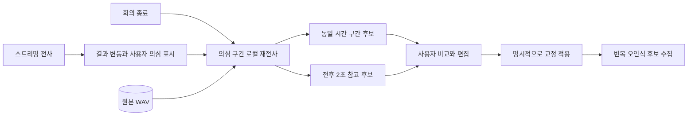

# P1 안정화와 오인식 검토 — 0.13.0-beta.5

2026-11-03. [beta.4 설계 점검](audits/ARCHITECTURE-AUDIT-2026-11-03.ko.md)에서 발견한 P1 수정과 반복 교정/재전사 기능의 구현 기록이다. 기존 회의의 노트와 녹음을 일괄 수정하지 않는다.

## P1 수정

| 항목 | 변경과 확인 |
|---|---|
| F01 오류 종료 | 캡처 정지가 실패해도 화자 종료, 큐 등록, 전사·메트릭 체크포인트, DB 닫기를 각각 시도한다. 오류 주입에서 최초 오류 유지, transcript/metrics 저장, failed=true를 확인했다. |
| F02 진행 중 교정 | 잠정 발언은 화자만 수정하고 텍스트는 발언 종료 후 교정한다. 화자만 바꿔도 대사가 잠기는 문제를 제거했다. 이전 버전의 잠정 교정은 정확히 이어지는 새 접미부만 보존해 추가하고, 일치하지 않으면 사용자 교정을 유지한 채 후속 결과를 검토 후보로 남긴다. |
| F03 필기 위치 | 최신 문서를 읽을 때 저장 스냅샷과 다르면 복사본에서 필기 좌표를 재연결한다. 모호한 전체 치환으로 없어진 범위는 연결하지 않는다. 원래 필기와 입력 시각은 수정하지 않는다. |
| F04 화자 슬롯 | 잠정 군집 번호의 누적 발급 수를 최종 인물 상한과 분리했다. 늦은 새 후보도 별도 번호를 받는다. 비교 특징은 최근 64개까지만 유지하며 번호는 다른 사람에게 재사용하지 않는다. 모델 창/종료 후 분석에는 기존 최대/고정 인원이 적용된다. 잠정 후보 수가 참석 인원보다 많을 수 있다. |
| F05 미리보기 | 매 개정에 전체 회의를 복제하고 가상 문서 패치하던 경로를 선형 문자열 생성으로 교체했다. 자동 개정의 앱 메타데이터는 최대 3초 단위로 묶고 사용자 교정은 즉시 저장한다. 워커 원음·개정 로그는 계속 별도로 보존한다. |

추가로 F07의 ‘종료 후에도 실시간 검토 사유가 남는 문제’를 수정했다. F06의 저장 루트 변경/노트 이동 후 녹음 연결 개선은 이번 범위에 포함하지 않는다.

합성 3,000발언의 previewText 함수는 이전 약 823–842ms에서 약 0.3ms로 감소했다. 실제 Obsidian 전체 지연 측정은 아니다. 긴 한국어 텍스트의 TextReveal 생성/추가는 별도 측정에서 약 7–8ms였다. 전체 회의 수 시간의 p95와 메모리 안정성은 추가 검증 대상이다.

## 반복 오인식 사전 후보

발언 검토에서 확정된 대사를 직접 교정하면 `인식 원문 → 사용자 교정`의 변경 부분을 단어 경계로 확장해 모은다. 같은 발언을 여러 번 저장해도 한 번만 집계하고 서로 다른 발언 2개 이상에서 반복되면 후보로 표시한다. 교정을 되돌리면 해당 기여도도 갱신한다. 화자만 바꾼 경우와 숫자·짧은 부정 표현 변경은 용어 후보로 수집하지 않는다.

- **회의 사전 → 반복 오인식 후보**, 발언 검토 도구, 또는 **반복 오인식 사전 후보** 명령에서 확인한다.
- 동일한 오인식을 서로 다르게 교정한 경우 충돌 표시를 한다.
- **사전 등록 검토**로 표준 표기와 오인식을 미리 채운 용어 편집기를 연다. 사용자가 저장하기 전에는 사전/모델에 적용하지 않는다.
- 기본 등록 정책은 인식 힌트이며, 관측 오인식을 무조건 치환하는 규칙으로 만들지 않는다.
- 일반 필기 전체를 오인식 정답으로 취급하지 않는다. 현재 수집 경로는 발언 검토에서 확정한 교정 이력이다. 모델 가중치를 자동 학습하지 않는다.
- 저장은 저장 루트의 `.local-meeting-quality/correction-candidates-<Vault ID>.json`이며 다른 Vault와 분리한다. 최근 최대 5,000개 발언 기여도를 유지한다.

## 종료 후 의심 구간 재전사

새 회의에서는 말하는 중 텍스트가 여러 번 재작성된 구간, 반복 인식 의심, 사용자가 표시한 구간을 대상으로 로컬 Qwen을 사용해 후보를 만든다. 화자 미확정만으로 모든 발언을 재전사하지 않는다.

자동 작업은 한 번에 최대 8개, 약 60초의 작업 시작 예산으로 제한한다. 진행 중인 한 번의 추론은 중간 취소하지 않으므로 정확한 60초 종료 제한은 아니다. 남은 구간은 보류 목록에 남고 발언별로 다시 시도할 수 있다. 후보는 `retranscription.json`에 저장하며 `transcript.json`, WAV, 사용자가 고친 대사·화자는 덮어쓰지 않는다.

- 녹음 중 **발언 검토 → 종료 후 재전사할 의심 구간으로 표시**.
- 종료 후 **발언 검토 → 재전사 후보 발언**에서 원문과 비교한다.
- **재전사 후보를 편집기에 넣기**는 편집기에만 넣는다. 확인·수정 후 **교정 적용**을 눌러야 노트에 반영된다. 화자 선택은 현재 지정값을 유지한다.
- 전후 음성이 포함된 참고 후보는 인접 사람의 말도 포함할 수 있으므로 그대로 원래 발언으로 자동 적용하지 않는다.
- **이 구간 다시 전사**는 이미 화자별로 분할된 발언도 지원한다. 임시 요청 파일만 만들고 원래 워커 전사는 바꾸지 않는다.
- **종료 후 재전사 후보** 명령에서 원본 구간 후보 전체와 처리 보류 수를 확인한다. 종료 후 화자 분할로 시간 범위가 달라진 후보는 각 발언을 직접 검토해야 한다.
- 기존 회의는 자동 재전사하지 않으며 사용자가 발언별로 요청할 수 있다. AI 정리는 사용자가 승인해 노트에 반영한 내용을 기준으로 한다. 재전사 후보를 적용한 뒤 이전 AI 정리는 필요하면 다시 생성한다.

두 후보가 더 정확하다는 보장은 없다. 억양·사투리에 대한 개인화 학습 기능도 아니다. 음성 프로필과 사전·재전사 기능은 각각 사람 식별, 용어 힌트, 음성 재인식으로 역할이 다르다.

## 검증

- 자동 검사 200개(TypeScript 132, Python 68) 통과.
- 최초 오류를 유지하면서 체크포인트 저장, 외부 수정 필기 재연결, 늦은 화자 후보 생성, 잠정 화자 수정 후 새 단어 보존, 잠정 대사 교정 차단, 이전 교정 충돌 후보 보존을 검사했다.
- 반복 후보 중복 집계 방지·숫자 변경 제외·되돌리기 기여도 제거·사전 등록 상태 유지, 재전사 원문 불변·시간 범위·예산 보류·분할 발언 요청을 검사했다.
- 실제 회의 녹음 첫 32초의 별도 복사본을 실시간 속도로 공급했다. 스트리밍 전사, 의심 표시, 후보 2개 생성, 종료 후 Community-1 분석까지 오류 없이 완료했다.
- 스피커 재생과 새 AI API 호출은 하지 않았다. 실제 한국어 정확도 개선율·화자 DER는 정답 자료가 없어 측정하지 않았다.
