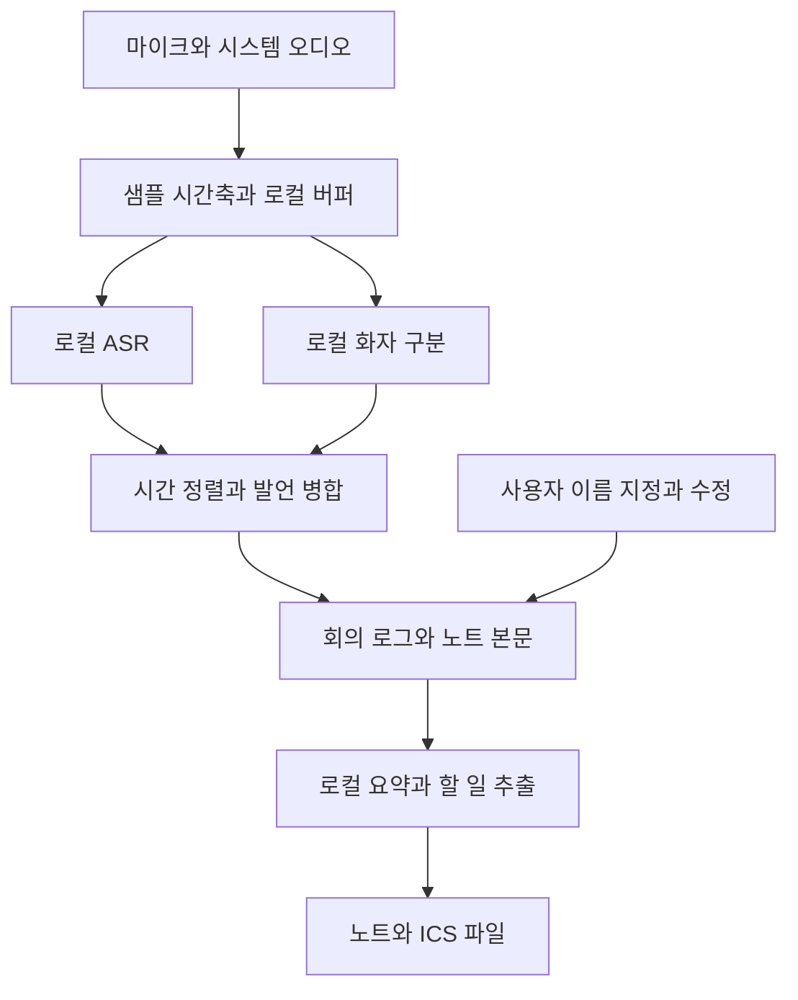

# 옵시디언 로컬 실시간 회의록 플러그인 개발 계획서

기준일: 2026년 10월 25일 · 대상: 현재 사용 중인 Apple M4 Mac · 버전: 1.0 최종 설계 · 구현 착수 · 실제 모델 성능 측정 전

회의 노트 본문에 한국어 발언을 실시간 입력하고, 화자를 구분해 이름을 지정하며, 회의 요약·결정 사항·할 일·일정 후보를 모두 로컬에서 생성한다. 외부 추론 API, 클라우드 대체 처리, 원격 요약, 외부 캘린더 API는 구성에서 제외한다. 모델과 실행 파일은 사전에 내려받거나 오프라인으로 반입하고, 회의 중에는 네트워크 없이 작동해야 한다.

**우선 검증할 조합은 한국어 미세조정 모델 TeamUNIVA/qwen3_asr_1.7b_ko의 Mac용 실행과 Nemotron 3 Diarization이다.** 같은 미세조정 가중치에서 8비트와 인코더 8비트·디코더 4비트 변환을 비교한다. 원본 Qwen3-ASR-1.7B는 비교 기준으로 둔다. ASR 속도 대안은 Qwen3-ASR-0.6B 및 Nemotron 3.5 ASR, 추가 비교 기준은 Whisper large-v3-turbo다. 이 선택은 현재 PC에서 검증할 후보의 우선순위이며, 해당 PC에서 측정한 정확도·지연 보증이 아니다. 특히 ASR과 화자 구분을 연결하는 시간 정렬과 장시간 화자 상태 유지가 핵심 개발 과제다.

# 최종 구현 결정과 단계별 완료 기준

저장소: https://github.com/organic4597/obsidian-local-meeting (비공개). 설계 기준선은 이 문서 v1.0이며, 코드의 구현 상태는 README와 docs/STATUS.ko.md에 별도로 기록한다. 최종 설계라는 표현이 기능 구현이나 모델 실측 완료를 뜻하지 않는다.

## 확정한 제품 동작

- 외부 추론 API 없이 Apple Silicon 데스크톱에서 실행한다. 회의 중 모델 자동 다운로드와 네트워크 추론 폴백은 없다.
- 녹음을 전사보다 우선한다. 제한된 RAM 버퍼 → 원본 PCM WAV 디스크 큐 → 단일 모델 전사 → 고정 노트 입력으로 분리한다. 큐의 평균 처리량이 입력량보다 작으면 지연이 계속 증가하므로 큐 길이와 미처리 오디오 범위를 표시한다.
- Qwen3-ASR 한국어 미세조정 모델은 STT만 담당한다. 자동 화자 구분은 별도 Nemotron 3 모델이 담당하며, 모델 출력 화자 ID와 사용자가 지정하는 실제 이름은 분리한다.
- 같은 한국어 미세조정 가중치의 8비트를 우선 검증하고, 동일 오디오로 혼합 4비트 변환을 비교한다. FLEURS 1.26%는 저자가 평가한 원본 미세조정 체크포인트 수치이며 변환본 수치가 아니다.
- 실시간 임시 텍스트와 화자 확정은 별도 상태다. 자동 구분이 연결되지 않은 개발판은 화자를 미확정으로 표시하고 수동 지정을 제공한다.
- 사용자가 수정하거나 삭제한 발언 블록은 자동 업데이트로 복원·덮어쓰지 않는다. 원본 오디오와 전사 결과는 복구할 수 있게 보존한다.
- 요약·할 일·일정은 원문 발언 ID를 근거로 연결하고, 담당자·기한을 추측하지 않는다. 외부 캘린더 대신 노트와 로컬 ICS로 제공한다.

## 단계별 구현 및 통과 조건

| 단계 | 구현 | 통과 조건 |
| --- | --- | --- |
| A: 기반 개발판 | TypeScript 플러그인, Python MLX 워커, 마이크 PCM 저장, SQLite 작업 큐, 노트 직접 입력, 수동 화자 지정 | 빌드·큐 복구·사용자 수정 보존·전사 실패 재시도 테스트, 명확한 미구현 표시 |
| B: 실제 모델 검증 | 미세조정 원본 다운로드, 8비트 변환, 로컬 경로 로딩, 한국어 오디오 전사 | 현재 M4에서 변환·추론 성공, 모델 해시·버전·실측 피크 메모리와 RTF 기록 |
| C: 실시간 품질 | 말끝 감지·중첩 구간 처리·임시/확정 전사 | 경계 단어 누락과 중복 검사, 장시간 지연 증가와 무음 환각 검사 |
| D: 자동 화자 | Nemotron 3 실행, 시간 정렬, 화자 상태 유지와 이름 매핑 | 한국어 2~8인 실제 회의의 DER·오귀속·중첩 발언 검사. 확인 전 자동 이름 추정 금지 |
| E: 문서 생성 | 로컬 요약 모델, 결정·할 일·일정 추출, ICS | 모든 추출에 근거 발언 ID, 담당자·일시 검증, 중복 일정 방지 |
| F: 배포 | 설치 패키지, 시스템 오디오, 권한·장애·복구 UX | 실제 Obsidian에서 녹음→전사→이름 지정→요약→ICS→재시작 복구 및 네트워크 차단 통합 검증 |

고정 8초 구간 전사는 A단계의 연결 검증용이다. 발언 도중 구간이 잘리거나 한 구간에 여러 화자가 포함될 수 있으므로 이를 완성된 단어 정렬·자동 화자 분리로 표기하지 않는다. 시스템 오디오를 별도 구현하기 전에는 기본 마이크만 녹음한다.

## 메모리 수치의 최종 해석

현재 M4에서 측정한 전체 앱 RAM 수치는 아직 없다. 비교 가능한 외부 실행기의 원본 Qwen 1.7B 피크 RSS는 8비트 2,563MB, 4비트 1,775MB이며, 별도 화자 구분 실험의 Nemotron MLX INT8 피크는 498MB였다. 다른 실험을 합쳐 현재 미세조정 모델의 실측값으로 주장하지 않는다.

짧은 버퍼·한 번에 한 ASR 추론·디스크 큐를 가정할 때, 개발 검증을 위한 추가 RAM 예상 범위는 8비트 STT+화자+기록 약 3~4GB, 혼합 4비트 약 2~3GB다. 이는 용량 확보용 추정치로, 기존 Obsidian·OS·회의 앱과 별도 요약 모델은 제외한다. 원본 미세조정 가중치 파일은 약 4.7GB이므로 원본을 그대로 로드하면서 위 범위를 보장할 수 없다. 실제 피크는 단계 B/D 통합 실측 후 갱신한다.

# 현재 PC와 지원 범위

운영체제 도구로 직접 확인한 값이다. 모델 다운로드·설치·회의 녹음·추론은 이번 조사에서 실행하지 않았다.

| 항목 | 확인값 |
| --- | --- |
| 칩 | Apple M4 |
| CPU | 10코어 |
| GPU | Apple M4 10코어, Metal 지원 |
| 메모리 | 통합 메모리 24GB |
| 운영체제 | macOS 26.6 |
| 옵시디언 | 1.11.7 |
| 작업 볼륨 가용 공간 | 약 153GiB, 조회 시점 기준 |
| 개발 도구 | Python 3.11 경로, uv, Swift, CMake 발견 |

Apple Silicon에서는 CPU와 GPU가 같은 메모리를 공유하므로 별도의 “VRAM 24GB”로 계산하지 않는다. OS·옵시디언·브라우저·회의 앱·모델이 이 공간을 함께 사용한다. NVIDIA GPU 벤치마크를 이 Mac의 속도로 대입하지 않는다.

첫 지원 대상은 이 Mac의 데스크톱 옵시디언이다. Windows·모바일·다른 CPU 지원은 후속 범위로 둔다. 기존 Python 환경은 변경하지 않고, 프로토타입에 필요한 경우 전용 환경을 사용한다. 배포판은 사용자가 Python을 직접 관리하지 않도록 네이티브 보조 프로그램 또는 묶음 런타임을 제공한다.

# 기존 계획에서 보완할 부분

| 부족했던 점 | 구현 방침과 확인 기준 |
| --- | --- |
| 실시간 전사의 정의가 불명확 | 발언 중 임시 텍스트, 확정 텍스트, 화자 확정 상태를 따로 표시한다 |
| 패널과 노트 저장의 관계 | 노트 본문이 주 기록이다. 패널은 녹음 제어·화자 관리·오류 확인을 보조한다 |
| 실제 이름을 자동으로 아는 것으로 오해할 수 있음 | 익명 화자 ID를 자동 생성하고 사용자가 이름을 연결한다. 회의 간 자동 신원 인식은 첫 버전에서 제외한다 |
| 문장 중 화자 변경 | 전체 문장 한 명으로 강제하지 않고, 단어·시간 구간을 화자 구간과 겹쳐 나눈다 |
| 짧은 맞장구와 동시 발언 | 미확정·중첩 표시를 허용한다. 알아듣지 못한 발언을 만들어 채우지 않는다 |
| 이름 변경을 문자열 치환으로 처리 | 화자 ID와 표시 이름을 분리하고, 해당 ID가 연결된 발언만 갱신한다 |
| 사용자의 원문 수정이 사라질 위험 | 텍스트 수정과 화자 수정을 별도 잠금으로 저장한다. 자동 보정은 잠긴 필드를 덮어쓰지 않는다 |
| 노트를 바꾸면 잘못된 문서에 입력될 위험 | 회의 시작 때 대상 파일을 고정한다. 탭·커서 변경은 입력 대상을 바꾸지 않는다 |
| STT를 매번 새로 실행할 위험 | 모델은 프로세스에 상주시킨다. 일정 길이의 중첩 버퍼를 재사용한다 |
| 화자 모델의 인원 제한 | 4화자와 8화자 모델을 구별한다. 최대 인원 초과를 기존 사람으로 조용히 합치지 않는다 |
| 오디오 시간축 불일치 | 모든 입력·모델 결과를 회의 시작 기준 샘플 인덱스와 밀리초로 통일한다 |
| 온라인 회의 상대방 음성 누락 | 마이크와 시스템 소리 각각의 입력 레벨·실제 샘플 수를 확인한다 |
| 마이크와 스피커의 중복 녹음 | 소스를 분리하고 헤드폰 사용을 기본 조건으로 검증한다. 에코 제거는 별도 과제로 평가한다 |
| 메모리·GPU 경합 | 녹음과 전사를 우선한다. 요약은 남는 시간에 실행하고 지연이 쌓이면 일시 중지한다 |
| 앱 종료·잠자기·장치 분리 | 상태 전이와 원본 오디오 임시 저장, 재시작 복구, 불연속 표시를 구현한다 |
| 요약의 담당자·기한 추측 | 근거 발언 ID를 요구한다. 언급되지 않은 값은 미정으로 남긴다 |
| 일정 기록과 외부 일정 생성이 혼재 | 로컬 노트와 ICS 파일 내보내기만 지원한다. 자동 외부 캘린더 등록은 제외한다 |
| 로컬 처리인데 숨은 네트워크가 생길 위험 | 모델 자동 다운로드·원격 폴백·원격 로그 전송을 회의 실행 경로에서 차단한다 |
| 공개 성능 수치를 한 순위로 비교 | 데이터·정밀도·실행기·하드웨어·지연 정의가 같은 경우에만 직접 비교한다 |
| 배포 가능 여부 미확인 | 모델 원본·변환본·코드·토크나이저의 라이선스를 각각 기록하고 버전을 고정한다 |

# 로컬 STT 모델 후보

| 모델 | 역할과 실행 방식 | 현재 판단 |
| --- | --- | --- |
| Qwen3-ASR-1.7B | 한국어 지원, 공식적으로 오프라인·스트리밍 지원. Mac은 MLX 실행기 검증 | 한국어 미세조정·양자화 효과를 확인할 비교 기준 |
| Qwen3-ASR-0.6B | 같은 계열의 경량 모델 | 저지연·저전력 프로필 및 부하 시 사용자가 선택할 대안 |
| TeamUNIVA qwen3_asr_1.7b_ko | Qwen3-ASR의 한국어 미세조정 모델 | 한국어 회의용 우선 채택 후보. 같은 가중치의 Mac 변환·8비트·혼합 4비트 품질 검증 |
| Whisper large-v3-turbo | 한국어 지원. whisper.cpp의 Metal 또는 MLX 실행 | 구현 및 정확도 비교 기준. 오디오 버퍼를 반복 전사하는 지연을 포함해야 함 |
| Whisper large-v3 | 상대적으로 큰 모델 | 종료 후 보정 후보. 같은 계열이라고 turbo보다 항상 실제 회의에서 낫다고 가정하지 않음 |
| Nemotron 3.5 ASR Streaming 0.6B | 한국어가 공식 지원되는 캐시 기반 스트리밍 ASR | 속도 중심 비교 후보. Mac용 네이티브 실행 경로 확인 |
| Fun-ASR-MLT-Nano-2512 | 한국어 포함 다국어 800M 모델 | 추가 후보. 배포 시 원본·변환본 라이선스 차이를 확인 |
| Cohere Transcribe 03 2026 | 한국어 포함 14언어, 2B 오픈 모델 | 파일·종료 후 전사 후보. 실시간용으로 자동 승격하지 않음 |
| Moonshine base ko | 소형 한국어 모델 | 저사양 대안. 모델 라이선스와 전문용어 품질 확인 전 기본값으로 채택하지 않음 |
| MOSS Transcribe Diarize 0.9B | 전사·타임스탬프·화자 라벨을 한 번에 출력 | 종료 후 재처리 비교 후보. 실시간 캐시와 Mac 실시간 경로는 확인 필요 |

Qwen3-ASR는 화자 식별 모델이 아니다. MLX 실행기의 “스트리밍 토큰 출력”과 실제로 계속 도착하는 오디오의 처리도 구분해야 한다. 선택할 MLX 실행기는 오디오 윈도 재전사·텍스트 롤백을 지원하는지 테스트한다. 일부 실행기의 화자 구분 옵션은 오프라인에만 적용된다.

근거: [Qwen 공식 모델 카드](https://huggingface.co/Qwen/Qwen3-ASR-1.7B), [Mac용 실행기와 제한](https://github.com/moona3k/mlx-qwen3-asr), [한국어 미세조정 모델](https://huggingface.co/TeamUNIVA/qwen3_asr_1.7b_ko), [Whisper](https://github.com/openai/whisper), [NVIDIA ASR](https://huggingface.co/nvidia/nemotron-3.5-asr-streaming-0.6b), [Fun-ASR](https://huggingface.co/FunAudioLLM/Fun-ASR-MLT-Nano-2512), [Cohere 모델 설명](https://docs.cohere.com/docs/transcribe), [Moonshine 한국어 카드](https://huggingface.co/moonshine-ai/moonshine-base-ko), [MOSS](https://huggingface.co/OpenMOSS-Team/MOSS-Transcribe-Diarize).

# 한국어 성능 수치

## 같은 실행기에서 측정된 한국어 비교

Handy 개발팀의 transcribe.cpp 벤치마크 원문 표를 확인했다. FLEURS 한국어 test, Q8_0 조건의 공개 수치다. 속도는 AMD Ryzen 4750U의 값이며 이 PC의 M4 속도가 아니다. 파일 크기는 해당 실행기의 Q8_0 GGUF 크기이며 실행 RAM이 아니다.

| 모델 | CER 낮을수록 좋음 | AMD GPU 실시간 대비 배속 | AMD CPU 실시간 대비 배속 | 해당 모델 파일 |
| --- | --- | --- | --- | --- |
| Qwen3-ASR-1.7B | 4.60% | 4.1배 | 2.5배 | 2.04GB |
| Whisper large-v3 | 4.89% | 2.0배 | 1.0배 | 1.55GB |
| Whisper large-v2 | 4.99% | 2.0배 | 1.0배 | 1.55GB |
| Fun-ASR-MLT-Nano-2512 | 5.20% | 8.8배 | 5.5배 | 0.83GB |
| Whisper large-v3-turbo | 5.24% | 3.1배 | 1.4배 | 0.83GB |
| Whisper large | 5.25% | 2.0배 | 1.0배 | 1.55GB |
| Voxtral Mini 4B Realtime 2602 | 5.27% | 0.8배 | 0.6배 | 4.41GB |
| Whisper medium | 5.46% | 4.1배 | 1.9배 | 0.77GB |
| Qwen3-ASR-0.6B | 5.82% | 9.7배 | 5.3배 | 0.79GB |
| Cohere Transcribe 03 2026 | 6.57% | 8.1배 | 4.3배 | 2.25GB |
| Whisper small | 7.70% | 11.7배 | 5.9배 | 0.25GB |
| Moonshine base ko | 8.12% | 17.5배 | 11.2배 | 0.07GB |
| SenseVoiceSmall | 8.27% | 27.7배 | 19.7배 | 0.24GB |
| Nemotron 3.5 ASR Streaming 0.6B | 8.89% | 17.1배 | 10.6배 | 0.70GB |
| Moonshine tiny ko | 9.00% | 30.3배 | 20.5배 | 0.03GB |
| Whisper base | 12.98% | 29.0배 | 19.3배 | 0.08GB |
| Whisper tiny | 19.07% | 43.1배 | 39.8배 | 0.04GB |

이 표는 짧은 낭독 음성의 결과다. 동시 발언·회의실 잔향·장시간 화자 구분·M4 발열·최초 자막 지연을 측정한 표가 아니다. 속도 배속으로 자막 지연을 역산하지 않는다. 이 출처의 라이선스 열은 원본 모델 카드와 불일치하는 항목이 있어 배포 근거로 사용하지 않았다.

출처: [Handy 한국어 모델 비교 원문](https://models.handy.computer/languages/ko/).

## 한국어 미세조정 모델의 별도 평가

TeamUNIVA 작성자가 같은 평가 절차에서 비교한 수치다. 원문의 비율을 백분율로 환산했다.

| 평가셋 | Qwen3-ASR-1.7B 기본 CER | 한국어 미세조정 CER |
| --- | --- | --- |
| ClovaCall | 4.48% | 2.83% |
| Common Voice 한국어 | 7.19% | 6.03% |
| FLEURS 한국어 | 1.42% | 1.26% |
| KsponSpeech | 8.65% | 5.94% |
| Zeroth | 2.64% | 2.20% |
| 작성자 집계 전체 | 6.86% | 4.83% |

8,383개 발화의 검수·선별 평가이며, TN과 ITN 두 정답 중 더 잘 맞는 정답으로 점수를 계산한다. 따라서 위 Handy FLEURS 4.60%와 이 표의 1.42%를 서로 같은 조건으로 비교하면 안 된다. 미세조정 모델의 한국어 라이브 스트리밍·양자화 결과는 별도 확인 대상이다.

출처: [TeamUNIVA 평가와 평가셋 설명](https://huggingface.co/TeamUNIVA/qwen3_asr_1.7b_ko).

# 실제 공개 자원 수치와 적용 한계

## Apple Silicon ASR 실행 수치

mlx-qwen3-asr 개발자가 Apple M4 Pro 48GB, macOS 26, v0.4.0에서 측정한 10회 중앙값이다. 현재 M4 24GB에서 직접 측정한 값이 아니다. 완성된 클립의 처리 시간이며 오디오를 모으는 시간·화자 모델·요약·노트 갱신을 포함하지 않는다.

| 구성 | 약 2.5초 클립 처리 | 10초 클립 처리 | 보고된 10초 RTF |
| --- | --- | --- | --- |
| Qwen 0.6B FP16 | 0.17초 | 0.30초 | 0.029 |
| Qwen 0.6B 8비트 | 0.10초 | 0.23초 | 0.024 |
| Qwen 0.6B 4비트 | 0.09초 | 0.17초 | 0.018 |
| Qwen 1.7B FP16 | 0.36초 | 0.73초 | 0.077 |

RTF는 처리 시간 ÷ 오디오 길이다. 1 미만이면 처리량이 실시간을 따라갈 수 있다는 뜻이며, 0.1이라고 자막이 반드시 100ms 안에 표시된다는 뜻은 아니다. 시간과 RTF는 원문 값을 유지했으며 서로 다른 집계·반올림으로 정확히 일치하지 않을 수 있다.

같은 실행기가 안내하는 대략적 모델 메모리는 0.6B 약 1.2GB, 1.7B 약 3.4GB다. 정밀도·모델 파일·캐시·입력 길이에 따라 달라지므로 전체 프로세스 peak RSS나 이 PC의 실측값으로 사용하지 않는다.

[Mac 실행기 성능과 요구량](https://github.com/moona3k/mlx-qwen3-asr).

## 다운로드 크기와 실행 RAM은 다른 값이다

| 구성 또는 실행기 | 확인한 값 | 값의 의미 |
| --- | --- | --- |
| mlx-community Qwen3-ASR-1.7B 8비트 | 저장소 약 2.47GB | 해당 변환본 다운로드 크기 |
| mlx-community Qwen3-ASR-1.7B 4비트 | 저장소 약 1.61GB | 해당 변환본 다운로드 크기 |
| moona3k Qwen3-ASR-1.7B 8비트 | 약 2.0GB | 다른 양자화·변환 레시피의 크기 |
| moona3k Qwen3-ASR-1.7B 4비트 | 약 1.2GB | 4비트 디코더·8비트 인코더 |
| moona3k Qwen3-ASR-0.6B 8비트 | 약 801MB | 해당 변환본 다운로드 크기 |
| moona3k Qwen3-ASR-0.6B 4비트 | 약 517MB | 해당 변환본 다운로드 크기 |
| whisper.cpp small | 디스크 466MiB, 메모리 약 852MB | README의 일반 참고 구성 |
| whisper.cpp medium | 디스크 1.5GiB, 메모리 약 2.1GB | 같은 참고 표 |
| whisper.cpp large | 디스크 2.9GiB, 메모리 약 3.9GB | 같은 참고 표 |
| OpenAI Whisper turbo 원본 실행 | 약 6GB VRAM, A100 영어 속도 large 대비 약 8배 | 원본 실행기의 참고값, Mac·양자화 구성과 별개 |
| OpenAI Whisper large 원본 실행 | 약 10GB VRAM, 속도 기준 1배 | 같은 참고값 |

같은 모델 이름이어도 파일 크기가 다른 것은 인코더 정밀도·양자화 방식·파일 포맷이 다르기 때문이다. 4비트 크기에 8비트 정확도나 다른 런타임 메모리를 붙여 하나의 제품 수치처럼 제시하지 않는다.

근거: [MLX 8비트 파일](https://huggingface.co/mlx-community/Qwen3-ASR-1.7B-8bit/tree/main), [MLX 4비트 파일](https://huggingface.co/mlx-community/Qwen3-ASR-1.7B-4bit/tree/main), [1.7B 양자화 파일](https://huggingface.co/moona3k/mlx-qwen3-asr-1.7b-8bit), [0.6B 양자화 파일](https://huggingface.co/moona3k/mlx-qwen3-asr-0.6b-8bit), [whisper.cpp 메모리](https://github.com/ggml-org/whisper.cpp), [Whisper 원본 요구량](https://github.com/openai/whisper/blob/main/README.md).

NVIDIA용 faster-whisper의 공개 예에서는 RTX 3070 Ti 8GB로 13분 음성을 large-v2 INT8에서 59초·VRAM 2,926MB, FP16에서 63초·4,525MB로 처리했다. 이는 large-v3·M4·실시간 화자 포함 결과가 아니다. CUDA 실행기를 현재 Mac의 기본 엔진으로 택하지 않는다. [원본 측정 조건](https://github.com/SYSTRAN/faster-whisper).

# 로컬 화자 구분 모델과 최신 변경

## 우선 후보

**Nemotron 3 Diarization은 2026년 9월 23일 공개된 최대 8화자 모델**이다. 스트리밍·오프라인을 지원한다. 공식 입력 버퍼 설정은 0.32초·0.64초·1.04초·30.4초이며, 여기에 계산 시간과 후처리 지연이 더해진다. 앞서 검토한 4화자 Sortformer만으로 설계를 고정하지 않는다.

아래는 NVIDIA가 동일한 공식 평가 안에서 공개한 DER이다. 낮을수록 좋다. 서로 다른 모델 카드에서 가져온 수치를 혼합하지 않았다.

| 모델과 버퍼 | AMI SDM DER | NOTSOFAR1 단일채널 전체 DER |
| --- | --- | --- |
| Sortformer v2.1 · 1.04초 | 21.73% | 31.81% |
| Nemotron 3 · 1.04초 | 12.80% | 12.77% |
| Nemotron 3 · 0.32초 | 12.95% | 14.53% |
| Nemotron 3 · 30.4초 | 11.14% | 11.00% |

이는 한국어 화자 이름 정확도가 아니다. 공식 카드의 평가·후처리 조건에서 나온 익명 화자 시간 분할 오류율이다. 8명 제한을 회피하려고 여러 청크의 화자 번호를 그대로 이어 붙이지 않는다.

출처: [Nemotron 3 공식 모델 카드와 평가](https://huggingface.co/nvidia/Nemotron-3-Diarization).

## Mac 변환본에서 확인한 수치

| 구성 | 파일 크기 | 공개된 Mac 실행 참고 |
| --- | --- | --- |
| Nemotron 3 MLX INT8 변환 | 가중치 약 102MiB | Apple Silicon 소규모 파일 평가 peak RSS 498MB |
| Nemotron 3 Core ML INT8 변환 | 합계 약 103MiB | 같은 파일 평가 peak RSS 782MB |
| Sortformer Core ML | 변형당 약 230MB | 같은 파일 평가 peak RSS 305MB |

위 RSS는 Swift 런타임 작성자의 VoxConverse 5파일, 총 2,346.6초 평가다. 해당 설정의 DER은 각각 17.26%, 17.55%, 20.77%이며, 처리량은 333.4배·51.0배·113.1배다. 모델 로딩을 제외한 처리량이고, 한국어 실시간 평가가 아니다. 정확한 Mac 칩이 명시되지 않아 이 M4 성능으로 쓰지 않는다.

MLX·Core ML 변환본은 공개 기본 입력 모양이 30.4초다. 그 파일을 가져오는 것만으로 0.32초 실시간 처리가 완성되지 않는다. 스트리밍 설정에 맞는 입력 모양과 캐시·FIFO 갱신, 원본과의 일치 검증이 필요하다. Core ML이라는 이유만으로 Neural Engine에서 실행된다고 가정하지 않으며, 실제 실행 장치를 확인한다.

근거: [MLX 변환본](https://huggingface.co/aufklarer/Nemotron-3-Diarization-100M-MLX-INT8), [Core ML 변환본](https://huggingface.co/aufklarer/Nemotron-3-Diarization-100M-CoreML-INT8), [작성자의 Mac 비교](https://github.com/soniqo/speech-swift/blob/main/docs/benchmarks/diarization.md).

## 대안과 기능 경계

- **Sortformer v2.1:** 4명 이하 회의의 실시간 대안이다. Core ML 스트리밍 변환은 480ms씩 입력하며, 작성자 측정의 모델 호출 중앙값은 8.1ms다. 이 값은 전체 화자 확정 지연이 아니다. [변환본 조건](https://huggingface.co/aufklarer/Sortformer-Diarization-CoreML)
- **pyannote community-1:** 종료 후 전체 회의 재분석 후보다. 공식 오프라인 파이프라인을 실시간이라고 부르지 않는다. 원본 카드의 AMI SDM DER 19.9%는 다른 평가 프로토콜이므로 위 표와 직접 순위를 매기지 않는다. [모델 카드](https://huggingface.co/pyannote/speaker-diarization-community-1)
- **diart:** 온라인 클러스터링 대안이다. 0.5~5초 지연 설정을 제공하지만, 현재 모델·의존성과 Mac 실행을 별도 검증한다. [공식 구현](https://github.com/juanmc2005/diart)
- **8화자 Ultra-Sortformer:** 한국어 합성 데이터로 확장한 실험 후보다. 원본 4화자의 공개 성능을 8화자 모델 성능으로 옮겨 적지 않는다. [변환본 제한](https://huggingface.co/aufklarer/Ultra-Sortformer-Diarization-CoreML)
- **MOSS 0.9B:** 전사와 화자를 함께 출력하는 종료 후 처리 대안이다. 한국어 포함 다국어를 지원하지만, 현재 확인한 공개 표는 이 PC의 한국어 실시간 성능을 제공하지 않는다. [모델 카드](https://huggingface.co/OpenMOSS-Team/MOSS-Transcribe-Diarize)

# 이 PC에 맞춘 모델 선택과 자원 예산

## 권장 검증 순서

1. TeamUNIVA/qwen3_asr_1.7b_ko의 원본 정밀도 출력을 기준으로 Mac 변환을 확인하고, 같은 가중치의 8비트 및 인코더 8비트·디코더 4비트를 비교한다. FLEURS 한국어 외에 KsponSpeech·ClovaCall·실제 회의 녹음에서도 정확도·처리량·메모리를 확인한다.
2. Qwen3-ASR-0.6B 8비트와 Whisper large-v3-turbo를 같은 오디오·같은 윈도 조건으로 비교한다.
3. 더 짧은 지연이 필요하면 Nemotron 3.5 ASR의 네이티브 스트리밍을 비교한다.
4. 화자는 Nemotron 3 Diarization의 1.04초 설정부터 검증하고, 0.64초·0.32초로 줄일 때 정확도 손실을 측정한다.
5. Mac용 8화자 런타임의 저지연 구현이 기준을 못 맞추면, 4명 이하 실시간 모드와 수동 화자 지정 모드를 명시적으로 제공한다. 5명 이상에서 4화자 모델을 자동 적용하지 않는다.
6. 원본 Qwen 모델의 4비트·8비트 결과를 미세조정 모델의 결과로 대입하지 않는다. FLEURS 한국어 CER 1.26%는 작성자의 미세조정 모델 평가이며 해당 양자화본의 보장값이 아니다.

Qwen 계열은 입력 오디오 윈도를 재전사하는 방식, Nemotron ASR은 캐시를 유지하는 방식이므로 동일한 “stream” 옵션 이름으로 처리하지 않는다. [Qwen Mac 실행 방식](https://github.com/moona3k/mlx-qwen3-asr), [NVIDIA 네이티브 런타임](https://github.com/NVIDIA/NeMo-Speech.cpp).

## 상주 메모리와 일시적 피크

기존의 ASR 3~5GiB·화자 0.5~1.5GiB·정렬 1~2GiB·요약 4~6GiB 예산은 폐기한다. 선택한 모델 파일·정밀도·실행기의 실제 메모리 측정에 근거하지 않았고, 상주 작업과 필요할 때만 실행할 작업을 혼합했다. 설치 디스크 공간도 메모리 예산에서 분리한다.

**플러그인을 켜 두는 상태, 회의 처리 중 상태, 추론 순간의 최대 사용량을 각각 측정한다.** 총 RAM 예산은 현재 미확정이다. 파일 크기를 RAM 사용량으로 등치하지 않으며 RSS·Metal 메모리·OS 메모리 압력을 중복 합산하지 않는다.

| 상태 | 메모리에 유지할 것 | 자원 산정 원칙 |
| --- | --- | --- |
| 플러그인 대기 | UI·설정·가벼운 상태 | 모델 워커는 실행하지 않음. 플러그인 증가분 실측 |
| 녹음 중 | 캡처·작은 순환 버퍼·디스크 큐 위치 | 전체 녹음을 RAM에 쌓지 않음. PCM16 16kHz mono 60초는 약 1.92MB |
| 회의 전사·화자 처리 중 | 선택한 ASR 1개와 화자 상태 | 처리 중에는 가중치 재사용. 로드 완료 후 안정 상태와 추론 피크를 별도 측정 |
| 단어 정렬 | 필요한 확정 구간과 정렬 모델 | 구간 단위 작업. 계속 상주시키지 않음 |
| 회의 종료 후 요약 | 로컬 요약 모델과 제한한 문맥 | ASR 큐를 완료하고 해당 워커를 해제한 뒤 실행 |
| 회의 처리 완료 | 저장된 노트·작업 상태 | 추론 워커 종료 및 모델 메모리 반환 확인 |

현재 수치로 확인할 수 있는 기준점은 Qwen3-ASR-1.7B MLX 8비트 변환본의 저장소 크기 약 2.47GB와, 별도 Apple Silicon 시험에서 Nemotron 3 MLX 화자 런타임의 peak RSS 약 498MB다. 전자는 디스크 크기이고 후자는 특정 실행 조건의 피크이므로 더해서 이 제품의 상주 RAM으로 제시할 수 없다. [Qwen 파일 크기](https://huggingface.co/mlx-community/Qwen3-ASR-1.7B-8bit/tree/main), [화자 런타임 측정 조건](https://github.com/soniqo/speech-swift/blob/main/docs/benchmarks/diarization.md).

녹음과 변환을 분리하고, 오디오 청크를 디스크 큐에 저장한 뒤 순서대로 처리한다. 같은 워커에서 STT 작업을 직렬화해 동시 추론 수에 따라 메모리가 늘어나는 것을 막는다. 화자 캐시는 회의 동안 이어가고, 전사·정렬·요약의 큰 작업 메모리를 가능한 한 시간차로 사용한다. 매 청크마다 ASR을 새로 로드하면 로딩 비용이 커지므로, 큐 처리 중에는 모델을 유지하고 회의 처리 완료 후 해제한다.

설치 공간은 채택한 가중치·토크나이저·런타임 파일의 실제 합계와 변환·업데이트 임시 공간으로 계산한다. 보관할 녹음 파일은 별도다. 모델 로드 전, 로드 후, 첫 추론 피크, 연속 처리 안정 상태, 요약 전환 후, 워커 종료 후를 비교해 최종 메모리 요구량을 정한다.

완전 로컬 구성에는 분당 추론 API 비용이 없다. 전력·디스크·개발·유지 비용은 남는다. 전력 소비와 배터리 지속 시간은 공개된 다른 기기의 수치로 채우지 않고, 이 PC에서 동작 모드별로 측정한다.

# 실시간 노트 입력과 화자 이름 지정

## 사용자 흐름

1. 회의 제목·대상 노트·입력 장치를 선택한다.
2. “입력 확인”에서 마이크와 시스템 소리 각각의 레벨을 확인한다.
3. “회의 시작”을 누르면 회의록 영역에 임시 텍스트가 나타난다.
4. 인식이 안정화된 구간을 확정 문장으로 기록한다.
5. 발언 옆 “화자 1”을 클릭해 이름을 지정한다.
6. “이 회의의 같은 화자 전체” 또는 “선택 발언만” 중 적용 범위를 고른다.
7. 회의를 종료하면 남은 오디오와 텍스트를 확정하고 요약·할 일·일정 후보를 생성한다.

## 노트 표현 예시

> [00:01:12] **김민수** 초안을 준비하겠습니다.  
> [00:01:18] **박지연** 제가 검토할게요.  
> [00:01:25] **화자 미확정** 다음 주 수요일에 확인하죠.

발언마다 고정 ID를 두고, Live Preview에서는 화자 이름을 누를 수 있는 표시로 렌더링한다. 원문 모드에서도 시간·이름·본문을 읽을 수 있는 일반 Markdown을 유지한다. 색상 외에 이름과 상태 텍스트를 사용해 구별한다.

임시 텍스트는 CodeMirror 장식으로 표시하고, 확정 구간만 본문에 삽입한다. 임시 상태의 영속화가 필요하면 이벤트 로그에 저장한다. 타이핑 커서를 따라 입력하는 대신 고정된 회의록 영역에 기록하고, 사용자가 다른 문단을 편집할 때는 스크롤을 강제로 이동하지 않는다.

화자 이름 변경·병합은 하나의 되돌리기 작업으로 처리한다. 같은 이름이 일반 문장에 등장해도 치환하지 않는다. “화자 2”와 “화자 5”를 병합할 때는 이전 연결 이력을 보존한다. 회의 간 자동 목소리 재인식과 음성 지문 등록은 별도 후속 기능이다.

옵시디언의 편집기 확장은 CodeMirror 6 기반이다. [공식 편집기 확장 문서](https://github.com/obsidianmd/obsidian-developer-docs/blob/main/en/Plugins/Editor/Editor%20extensions.md).

# 로컬 구조와 오디오 처리

플러그인은 TypeScript로 만들고, 모델 추론은 옵시디언 편집기 프로세스 밖의 보조 프로그램에서 실행한다. 플러그인과 보조 프로그램은 표준 입출력 또는 로컬 IPC로 연결한다. HTTP 서버와 외부 API 호출을 요구하지 않는다.

**처리 흐름**

| 모듈 | 책임 |
| --- | --- |
| CaptureController | 입력 장치, 권한, 오디오 레벨, 일시 중지, 장치 분리 |
| AudioClock | 샘플 인덱스, 재개 오프셋, 두 입력 소스 시간 맞춤 |
| ModelManager | 로컬 파일 검증, 버전·해시·정밀도, 모델 로드·해제 |
| AsrWorker | 중첩 윈도 또는 캐시 기반 전사, 임시·확정 텍스트 |
| DiarizationWorker | 화자 캐시 유지, 중첩 발언, 미확정 상태 |
| AlignmentWorker | 확정 텍스트와 오디오의 단어·구간 시간 정렬 |
| TranscriptReconciler | 중복 제거, 순서 보정, 텍스트 수정과 화자 수정 적용 |
| NoteWriter | 파일 고정, 편집 충돌, 변경 영역만 갱신, 되돌리기 |
| SessionStore | 이벤트 순서, 체크포인트, 원문·수동 수정 이력 |
| LocalSummarizer | 근거 ID를 가진 요약·결정·할 일·일정 후보 |
| Exporter | 회의 Markdown과 ICS 파일 생성 |

## 오디오와 시간 정렬

- 수집 원본은 장치 샘플레이트를 보존하고, 추론용 16kHz mono PCM을 만든다. 장치가 원래 48kHz라고 16kHz로 잘못 표기해 보내지 않는다.
- 20~40ms 수집 프레임과 0.5~1초 화면 갱신은 초기 설계값이다. 모델의 실제 청크 크기와는 별도로 관리한다.
- ASR 오디오 윈도는 예를 들어 4~8초부터 시험하고 1~2초 중첩을 비교한다. 모델·문장 길이에 맞춰 조정하며 고정 성능 수치로 제시하지 않는다.
- 각 결과에 startSample·endSample을 부여한다. 서로 다른 모델의 상대 시간을 회의 전체 절대 오프셋으로 변환한다.
- 전사 윈도 경계는 최근 단어와 타임스탬프를 함께 사용해 중복을 제거한다. 같은 문장을 실제로 반복한 발언을 지우지 않는다.
- 화자 경계와 단어 시간이 겹치는 비율로 화자를 연결한다. 동시 발언 구간은 주화자 하나로 숨기지 않고 중첩 또는 미확정 상태를 남긴다.
- Qwen의 단어 시간은 필요시 별도 강제 정렬 모델로 얻는다. 생성 토큰의 도착 시각을 음성의 단어 시각으로 쓰지 않는다.
- 잠자기·입력 장치 변경·재시작으로 생긴 공백은 시간 불연속 이벤트로 기록한다.

시스템 소리 수집은 macOS 네이티브 캡처를 검증한다. 옵시디언 플러그인만으로 권한과 앱 번들 설정을 모두 제어할 수 있다고 가정하지 않는다. 필요하면 안정적인 bundle ID를 가진 서명된 보조 앱으로 권한 요청과 캡처를 맡긴다. [Apple ScreenCaptureKit](https://developer.apple.com/documentation/screencapturekit), [Electron 캡처 제약](https://www.electronjs.org/docs/latest/api/desktop-capturer).

# 저장 구조와 수정 우선순위

회의 본문은 일반 Markdown으로 보존하고, 구조 데이터와 복구 로그를 함께 관리한다. 개발은 기존 보관함이 아닌 별도 테스트 보관함에서 수행한다. [옵시디언 공식 개발 안내](https://docs.obsidian.md/Plugins/Getting%20started/Build%20a%20plugin).

| 데이터 | 필요한 필드 |
| --- | --- |
| Meeting | meetingId, notePath, startedAt, timezone, sampleRate, status, schemaVersion |
| Speaker | speakerId, displayName, aliasHistory, manualName |
| Segment | segmentId, revision, sourceId, startSample, endSample, asrText, userText |
| 화자 연결 | modelSpeakerId, canonicalSpeakerId, attributionStatus, manualSpeakerOverride |
| 모델 실행 | modelId, revisionHash, quantization, runtimeVersion, streamingConfig |
| ActionItem | itemId, text, ownerSpeakerId 또는 명시 이름, due, evidenceSegmentIds, status |
| EventCandidate | eventId, title, rawDateText, start, end, timezone, evidenceSegmentIds, confirmed |
| Recovery | eventSeq, lastCommittedSample, audioChunkIndex, lastNoteHash |

예시 폴더는 Meetings 아래 회의별 Markdown과 첨부 폴더를 두고, 오디오·JSONL 로그·체크포인트를 저장하는 구조다. 실제 숨김 여부와 동기화 경로는 설정에서 정한다. 모델 가중치와 실행 파일은 보관함 밖 전용 캐시에 두어 옵시디언 Sync에 대용량 모델이 올라가지 않게 한다.

**수정 우선순위는 사용자 수정 > 확정된 자동 결과 > 임시 자동 결과다.** 텍스트 잠금과 화자 잠금을 따로 둔다. 화자 자동 재판정이 와도 사용자가 직접 정한 연결을 바꾸지 않는다. 이름 변경은 화자 ID의 표시를 바꾸며, 누가 작업을 하기로 했는지에 대한 담당자 추론은 별도 근거가 있어야 한다.

노트 전체를 반복해서 다시 쓰지 않는다. 관리 영역과 고정 발언 ID를 이용해 바뀐 구간만 편집기 transaction으로 갱신한다. 본문이 다른 플러그인·동기화에 의해 수정되면 최신 내용을 다시 읽고 위치를 재확인한다. 이벤트 저장과 노트 반영이 중간에 끊겨도 eventSeq와 revision으로 재실행해 중복을 방지한다.

음성 원본을 남기지 않는 모드도 제공하지만, 이 경우 종료 후 재전사와 일부 충돌 복구가 제한됨을 설정에 설명한다. 오디오 임시 저장은 전체를 메모리에 쌓는 대신 작은 파일로 순차 기록한다.

# 로컬 요약과 할 일 및 일정 처리

STT와 별도의 로컬 텍스트 모델을 사용한다. 시작 후보는 Qwen3-4B-Instruct-2507의 양자화 버전처럼 한국어 지시를 처리할 수 있는 4B급 모델이며, 같은 인터페이스로 교체할 수 있게 한다. 모델 이름이 결정됐다는 이유로 한국어 회의 요약 품질까지 검증됐다고 보지 않는다. [모델 카드](https://huggingface.co/Qwen/Qwen3-4B-Instruct-2507).

첫 버전은 종료 후 요약을 기본값으로 한다. 문맥을 무한히 넣지 않고 안건·시간 구간별로 요약한 뒤, 원문 ID를 유지한 상태에서 최종 통합한다. 반복 재요약으로 결정 사항이 바뀌거나 할 일이 중복되지 않도록 원본 발언 ID와 항목 ID를 키로 관리한다.

추출 결과는 JSON 스키마로 검증한다. 로컬 실행기의 문법 제약은 구조 유효성에 도움이 되지만 사실 정확성을 보장하지 않는다. [llama.cpp 문법 제약](https://github.com/ggml-org/llama.cpp/blob/master/grammars/README.md).

| 출력 | 규칙 |
| --- | --- |
| 요약 | 핵심 논점과 합의 내용을 원문에 연결 |
| 결정 사항 | 제안·논의 중·확정 결정을 구별 |
| 할 일 | 할 내용, 담당자, 기한, 근거 발언. 없으면 미정 |
| 일정 후보 | 날짜 원문, 해석된 날짜·시간·시간대, 근거 발언 |
| 쟁점 | 결론이 없거나 상충한 발언을 함께 남김 |

“제가 검토할게요”는 해당 발언의 확정 화자에 연결할 수 있다. 반대로 “민수님이 해주실 수 있나요?”는 수락이 없는 한 확정 담당자로 만들지 않는다. 화자 이름 수정 후 작업 담당자가 바뀌는 경우에도 근거를 표시한다.

“다음 주 수요일”은 회의 시작 날짜와 회의 시간대를 기준으로 해석한다. 기본 시간대는 Asia/Seoul이며 사용자가 바꿀 수 있다. 시작 시각이 없는 일정에 임의로 09:00을 넣지 않는다. 날짜·시간이 불명확하면 일정 후보로 남기고 확인을 받는다.

일정 기록은 노트의 일정 섹션과 로컬 ICS 내보내기로 구현한다. 동일 eventId에서 고정 UID를 사용하고 수정 시 SEQUENCE를 증가시켜 중복을 줄인다. 파일 가져오기 동작은 캘린더 앱마다 다르므로 재가져오기 결과도 확인한다. 외부 캘린더 API·자동 초대·메일 전송은 범위에 포함하지 않는다.

# 장애 처리와 완전 오프라인 동작

| 상황 | 처리 |
| --- | --- |
| 마이크 권한 없음 | 회의 시작을 차단하고 해당 입력의 설정 안내 |
| 시스템 소리 트랙은 있으나 샘플 없음 | 입력 확인 실패 표시. 마이크만 녹음 중임을 명확히 표시 |
| 모델 파일 누락 | 설치 단계로 안내. 회의 중 자동 네트워크 다운로드 금지 |
| 모델 로드 실패·메모리 부족 | 로컬 모델 변경 선택, 수동 기록 유지. 원격 처리로 전환하지 않음 |
| 추론 대기열 증가 | 실시간 요약·후처리 중지 후 전사 우선. 지연 시간을 표시 |
| 앱 재시작 | 원본 청크와 이벤트 로그로 재개 지점 제안. 중복 발언 생성 방지 |
| 보조 프로세스 재시작 | 화자 상태 연속성을 보장할 수 없으면 재확인 필요 표시 |
| 장치 분리·Bluetooth 변경 | 녹음 상태를 중단하고 대체 장치를 확인. 샘플레이트 재설정 |
| 긴 무음 | VAD로 불필요한 전사를 줄이고 반복·환각 문장을 기록하지 않도록 검증 |
| 동시 발언 | 중첩 표시와 원음 재생 지점 제공 |
| 사용자 노트 수정과 충돌 | 해당 자동 변경을 보류하고 사용자 내용을 보존 |
| 잘못된 요약·할 일 | 원문 이동·수정·삭제. 다시 생성해도 수동 수정한 항목 보존 |
| 디스크 공간 부족 | 보존 정책에 따라 정지·알림. 기존 기록 삭제로 조용히 해결하지 않음 |

회의 실행 시 원격 추론·원격 모델 조회·사용 로그 업로드를 사용하지 않는다. 필요한 가중치와 토크나이저를 로컬 경로로 고정하고, 네트워크가 차단된 상태에서 전체 흐름을 검증한다. 모델 설치와 업데이트는 회의 녹음과 분리하며 해시·버전·라이선스를 확인한다. 초기 모델 반입 이후에는 인터넷 연결이 필요하지 않아야 한다.

화자 라벨은 한 회의 안의 상대적 구분이다. 프로세스가 재시작되면 기존 “화자 1”과 새 “화자 1”을 무조건 같은 사람으로 연결하지 않는다. 녹음 원본을 이용한 로컬 재정렬 또는 사용자 재확인을 제공한다.

# 오디오 저장량과 측정할 자원

아래는 포맷으로 계산한 값이다. 실제 녹음 파일의 헤더·메타데이터와 저장 장치 오버헤드는 제외했다. MB는 10진수 단위다.

| 오디오 포맷 | 초당 데이터 | 시간당 저장량 |
| --- | --- | --- |
| 16kHz mono PCM16 | 32,000바이트 | 115.2MB |
| 24kHz mono PCM16 | 48,000바이트 | 172.8MB |
| 48kHz mono PCM16 | 96,000바이트 | 345.6MB |
| 48kHz stereo PCM16 | 192,000바이트 | 691.2MB |
| 32kbps 압축 오디오 | 4,000바이트 | 약 14.4MB |

16kHz mono PCM16의 60초 순환 버퍼는 약 1.92MB다. 원본 마이크·시스템 음성을 별도 보존하면 파일 수와 저장량이 늘어난다. 실제 인코더의 품질과 CPU 사용량을 확인한 뒤 압축 저장을 선택한다. 회의별 저장 상한·보존 일수·원본 삭제·노트만 남기기 설정이 필요하다.

M4에서 기록할 자원은 실행 프로세스별 peak RSS, Metal 활성·최대 메모리, CPU 사용량, OS 메모리 압력·스왑 변화, 처리 대기열 길이, 디스크 쓰기량, 오디오 유실 프레임이다. 전력은 가능한 시스템 측정값과 AC·배터리 조건을 함께 기록한다. CPU 사용률은 macOS 기준 100%가 한 코어인지 전체 CPU인지 표에 명시한다.

전사 단독, 전사+화자, 전사+화자+요약의 세 가지 구성을 비교한다. 모델 warm 상태와 최초 로드·컴파일 시간을 분리한다. 로딩을 뺀 “실시간 300배” 수치를 회의 시작 지연으로 사용하지 않는다. 2시간 연속 시험에서 발열 후 지연과 메모리 증가도 측정한다.

# 상세 구현 단계와 완료 조건

1명의 숙련 개발자가 현재 Mac 한 종류를 대상으로 작업하는 경우의 설계 추정이다. 모델 다운로드·한국어 정답 데이터 제작·배포 심사 대기는 별도다. 모델·런타임 저지연 변환 난이도에 따라 일정이 달라진다.

| 단계 | 구현 내용 | 완료 조건 | 예상 개발일 |
| --- | --- | --- | --- |
| 1 입력과 모델 실행 검증 | 마이크·시스템 오디오 권한, Qwen·Whisper·Nemotron 실행 경로 확인 | 두 입력 샘플을 파일로 검증, 모델 로컬 경로 실행 | 2~3일 |
| 2 한국어 성능 비교 | 동일 녹음 실시간 재생, 오류·지연·메모리 수집 | 후보 3~4개 재현 가능한 결과표 | 3~4일 |
| 3 노트 편집기 구현 | 가짜 STT 이벤트로 임시·확정 입력, 이름 지정·병합 | 타이핑 중 원문 보존, 다른 탭으로 입력 누출 없음 | 3~4일 |
| 4 실제 STT 연결 | 상주 워커, 윈도 중첩, 중복 제거, 취소·종료 처리 | 실제 발언이 본문에 저장되고 종료 후 마지막 발언 보존 | 4~5일 |
| 5 화자와 시간 정렬 | Nemotron 저지연 캐시, 단어 정렬, 수정 우선순위 | 2·4·6~8명 시험, 정해진 인원 초과 처리 | 5~8일 |
| 6 로컬 요약과 일정 | 구조 추출·근거 링크·할 일 병합·ICS | 원문 근거, 불명확 기한 미정, 외부 호출 없음 | 3~5일 |
| 7 복구와 패키징 | 장치 오류·재시작·오프라인·서명·설치·제거 | 2시간 시험과 완전 오프라인 종단 시험 통과 | 4~6일 |

합계는 약 24~35개 개발일이다. 한국어 평가 정답 작성은 데이터 양에 따라 추가 3~7개 작업일을 잡는다. 가장 먼저 확인할 관문은 1단계의 시스템 오디오 캡처와 2·5단계의 실제 M4 성능이다.

처음부터 모든 모델을 지원하지 않는다. 1차 설치 패키지는 ASR 1개·화자 1개·요약 1개를 제공하고, 나머지는 개발 비교용으로 둔다. 단, 플러그인 구조는 모델 교체를 수용하도록 분리한다.

macOS 첫 버전이 안정화되면 다른 Mac, Windows, 모바일 순서를 별도로 검토한다. 모바일은 외부 보조 프로세스·메모리·백그라운드 녹음 제약이 달라 같은 패키지로 자동 지원되지 않는다.

# 검증 데이터와 수용 기준

## 평가 데이터

첫 비교는 한국어 60~90분 파일로 시작하고, 최종 평가에는 겹치지 않는 한국어 회의 4~6시간을 사용한다. 안건·이름·숫자·영어 제품명·상대 날짜·잡음·원거리 마이크·짧은 맞장구·중첩 발언·2명·4명·6~8명을 포함한다. 인원수는 현재 확정되지 않았으므로 여러 조건을 계획에 남긴다.

실제 녹음을 모델에 실시간 속도로 공급해 평가한다. 파일 전체를 한 번에 처리한 시간을 실시간 지연이라고 부르지 않는다. 튜닝용과 최종 평가용 회의를 분리하고, 같은 사람·같은 회의가 양쪽에 걸쳐 결과가 좋아지는 것을 막는다.

정답은 텍스트·발언 시각·화자·할 일·일정 후보를 사람이 확인해 작성한다. 동시 발언은 별도 표기한다. 한국어는 문자 오류율 CER을 주 지표로 쓰고, 띄어쓰기 규칙을 고정한 WER과 원문 보존 점수도 함께 남긴다.

## 초기 수용 기준

아래 값은 **제품 목표이며 아직 달성된 결과가 아니다.** 첫 M4 실측 후 고정하고, 최종 평가셋을 본 뒤 유리하게 바꾸지 않는다.

| 영역 | 초기 목표와 판정 |
| --- | --- |
| 실시간 처리량 | 전사+화자의 평균 RTF 0.5 이하, 대기열이 지속 증가하지 않음 |
| 첫 임시 텍스트 | 발언 시작부터 P95 2초 이하 목표 |
| 확정 텍스트 | 발언 종료부터 P95 3초 이하 목표 |
| 화자 표시 | 오디오 구간 도착부터 P95 3초 이하 목표, 미확정 상태 허용 |
| 한국어 전사 | 조용한 회의 CER 10% 이하를 초기 목표로 두고 잡음·중첩은 별도 보고 |
| 화자 구분 | 조용한 2~4명 조건 DER 15% 이하 초기 목표, 6~8명은 별도 성적표 |
| 중요 정보 | 이름·금액·날짜·기한별 오류와 누락을 별도 집계 |
| 사용자 편집 | 수정 잠금·커서·Undo 손상 0건 |
| 저장 | 모델 이벤트 중복 전달·재시작 시험에서 중복·유실 0건 |
| 연속 사용 | 2시간 후 메모리가 선형 증가하지 않음, 녹음 프레임 유실 0건 |
| 할 일 추출 | 사람이 확인한 항목의 precision 90% 이상·recall 80% 이상 초기 목표 |
| 근거 | 생성한 결정·할 일·일정 후보에 유효한 근거 ID 100% |
| 날짜 해석 | 평가셋의 명시 날짜 해석 95% 이상 목표, 미지정 시간 임의 생성 0건 |
| 로컬 동작 | 네트워크 차단 후 전사·화자·요약·노트·ICS까지 완료 |
| API 호출 | 외부 추론·외부 일정·원격 폴백 호출 0건 |

DER는 collar 0초와 0.25초를 구분하고, 중첩 포함 여부를 기록한다. 화자 수 맞추기와 화자 이름 유지 정확도는 DER와 별도로 본다. 신뢰도 점수가 있더라도 보정 검증 전에는 “정답 확률 95%”처럼 표시하지 않는다.

모델별 결과표에는 모델·가중치 revision·변환 해시·정밀도·실행기 commit·OS·입력 포맷·오디오 해시·청크·중첩·화자 버퍼·샘플 수·성공률·P50/P95/P99 지연·CER·DER·peak RSS·Metal 메모리·부하 조건을 반드시 포함한다.

# 모델과 라이선스 관리

라이선스는 법률 자문을 대신하는 결론이 아니라 배포에 필요한 원문 식별 목록이다. 실제 묶음 배포 전에 고정한 revision의 LICENSE·NOTICE와 변환 이력을 확인한다.

| 구성 | 확인한 표기 | 배포 시 확인할 점 |
| --- | --- | --- |
| Qwen3-ASR 원본 | Apache 2.0 | 가중치·토크나이저·변환본 고지 |
| Qwen 한국어 미세조정 | Apache 2.0 | 미세조정 출처, 변환본 동일성 |
| Whisper 원본 | MIT | 변환 실행기와 모델 고지 각각 유지 |
| Nemotron 3.5 ASR | OpenMDW 1.1 | 원본 모델과 실행기 라이선스 분리 |
| Nemotron 3 Diarization | OpenMDW 1.1 | INT8 변환본 NOTICE와 원본 조건 유지 |
| Sortformer v2.1 | NVIDIA Open Model License | 변환본의 별도 CC BY 표기만 보고 원본 조건을 버리지 않음 |
| pyannote community-1 | 모델 카드 조건 확인 | 다운로드 시 접근 동의·인증과 오프라인 사용을 구분 |
| Fun-ASR·Moonshine | 원본과 비교표 표기가 다름 | 확인된 파일의 실제 라이선스를 기준으로 판단 |
| Qwen3-4B-Instruct-2507 | Apache 2.0 | 요약 모델 및 양자화본 고지 |

근거는 각 [Qwen](https://huggingface.co/Qwen/Qwen3-ASR-1.7B), [한국어 미세조정](https://huggingface.co/TeamUNIVA/qwen3_asr_1.7b_ko), [Whisper](https://github.com/openai/whisper), [NVIDIA ASR](https://huggingface.co/nvidia/nemotron-3.5-asr-streaming-0.6b), [Nemotron 화자 모델](https://huggingface.co/nvidia/Nemotron-3-Diarization), [Sortformer](https://huggingface.co/nvidia/diar_streaming_sortformer_4spk-v2.1), [pyannote](https://huggingface.co/pyannote/speaker-diarization-community-1), [요약 모델](https://huggingface.co/Qwen/Qwen3-4B-Instruct-2507) 원문이다.

모델 설치 기능은 예상 다운로드 용량·실행 환경·설치 위치를 먼저 보여준다. 사용자가 로컬 폴더를 선택하는 오프라인 반입도 지원한다. 가중치 해시를 확인한 뒤 실행하며, 모델 저장소의 원격 Python 코드를 런타임마다 새로 받아 실행하지 않는다.

# 현재 확정된 사항과 남은 검증

**확정된 요구사항**

- 현재 M4 24GB Mac에서 시작하는 완전 로컬 옵시디언 플러그인.
- 회의 노트 본문 실시간 입력, 화자별 발언 분리, 사용자 이름 지정과 수정.
- 로컬 요약·결정·할 일·일정 후보와 ICS 출력.
- 외부 API와 원격 대체 처리 제외.

**공개 자료로 확인된 사항**

- Qwen3-ASR 계열의 한국어 지원, Mac 실행기·양자화 변환본·공개 성능 수치.
- 최신 Nemotron 3 Diarization의 8화자·스트리밍 지원과 2026년 9월 23일 출시.
- Mac용 변환본의 파일 크기와 다른 Apple Silicon 장치에서의 일부 자원 측정값.
- Whisper·여러 로컬 STT의 조건부 한국어 비교 수치.
- 실시간·오프라인 화자 구분의 기능 차이와 런타임 연결 과제.

**이 PC에서 아직 측정하지 않은 사항**

- 한국어 회의에서의 실제 CER·DER·최초 자막 지연·화자 이름 연결 정확도.
- 전사+화자+요약 동시 실행 시 peak 메모리·발열·배터리·장시간 안정성.
- 마이크와 온라인 회의 시스템 소리의 권한·중복·시간 동기화.
- Nemotron 8화자 Mac 변환본의 0.32~1.04초 저지연 구성.
- Qwen 한국어 미세조정·4비트 변환의 실시간 정확도.
- 실제 회의 인원, 동시 발언 비중, 원본 오디오 보존 기간.

따라서 다음 구현 작업의 첫 산출물은 모델 하나를 미리 확정하는 것이 아니라, 이 PC에서 같은 한국어 녹음을 공급한 **로컬 벤치마크 결과와 노트 입력 프로토타입**이다. 이를 통과한 조합을 기본 모델로 고정한다.

