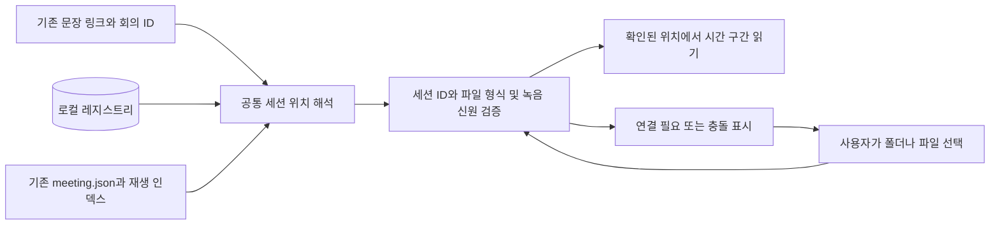
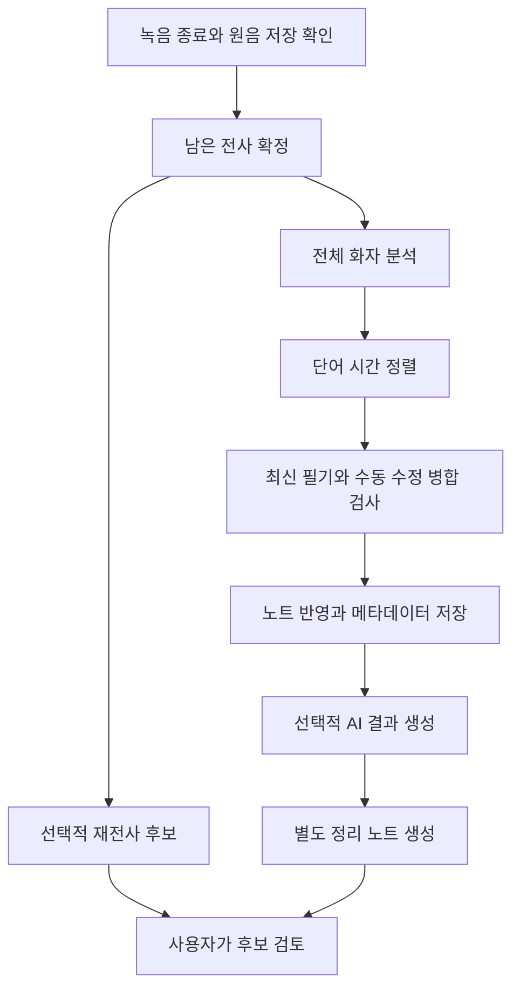

# 저장 위치 연결 개선과 단계별 재시도 구현 계획

작성일: 2026-11-03. 기준: `0.13.0-beta.5`, 커밋 `7801c2b`.

추가 요구사항 반영: 2026-11-04 — 새 회의 시작 시 지정한 Vault 폴더 아래 날짜 폴더와 회의록 자동 생성.

상태: **설계만 작성. 앱 코드 변경·기존 파일 이동·기존 회의 재처리·새 API 호출은 수행하지 않는다.** 구현은 1단계 저장 연결, 2단계 후처리 재시도 순서로 진행한다.

## 1. 목표와 보존 조건

1. 기본 녹음 저장 위치를 바꾸어도 과거 회의의 녹음 재생·복구·재전사가 원래 세션 위치를 사용한다.
2. 노트·폴더 이름을 바꾸어도 회의 원문, 요약 문장, 필기 시점과 녹음의 연결을 유지한다.
3. 후처리 실패 뒤 유효한 완료 결과를 재사용하고 필요한 단계만 재시도한다.
4. 사용자 필기, 대사 교정, 화자 이름·수동 배정, 삭제 의도, 교정 이력과 AI 검토 상태가 모델 재실행보다 우선한다.
5. 기존 회의·발언 ID와 녹음 시간축은 유지한다. 연결 개선을 이유로 Markdown에 ID·HTML 주석·frontmatter를 삽입하지 않는다.
6. 전환 작업은 추가 인덱스/상태 파일로 수행한다. 기존 WAV·PCM 큐·SQLite·회의 노트·요약을 일괄 덮어쓰거나 삭제하지 않는다.
7. 완료된 WAV는 바이트 단위 불변을 검사한다. 미완료 녹음의 WAV 헤더 복구가 필요하면 복구 동작에서 원본 백업과 PCM 보존을 보장한다. 연결 정보 수집 과정에서는 헤더 복구도 실행하지 않는다.

이 계획은 전체 변경 병합기 재작성, 완전한 부분 렌더링, 새 STT/화자 모델, 개인별 미세조정, 오디오 파생 파일 자동 정리를 포함하지 않는다. 기존 보호 함수를 공통 진입점으로 연결하는 데 필요한 범위만 수정한다.

## 2. 현재 구현과 차이

| 현재 beta.5 | 변경할 내용 |
|---|---|
| 요약 재생 인덱스가 노트 경로→세션 ID를 저장 | 노트 별칭→세션 ID→해당 장치의 실제 저장 위치로 해석 |
| 재생/복구 일부 경로가 현재 storage 설정을 기준으로 검사 | 공통 SessionResolver가 기존 위치를 검증해 제공 |
| 여러 전역 품질 데이터도 현재 storage에 종속 | 새 회의 기본 저장 위치와 사전·프로필·교정 후보 저장 위치의 연결을 분리 |
| rename/move 시 인덱스 갱신 경로 부족 | Vault 파일·폴더 rename 이벤트로 등록된 연결만 갱신 |
| 종료 후 전사 정리→재전사 후보→화자→정렬→본문→AI가 여러 함수에서 연결 | 단계별 입력·결과·실패 상태를 기록하는 후처리 조정자 추가 |
| 개별 결과 캐시와 일부 재시도는 존재 | 완료 여부뿐 아니라 입력 버전·결과 무결성을 확인해 재사용 |
| 노트 반영은 기존 write-ahead와 앵커 보호 사용 | 같은 보호 경로를 유지하고 단계 완료 영수증을 추가 |

## 3. 1단계 — 저장 위치 연결 개선

### 3.0 새 회의 시작 시 날짜 폴더와 문서 생성

새 회의의 기본 동작은 **지정한 Vault 폴더에 날짜별 새 회의록을 만든 뒤 녹음하는 것**으로 변경한다. 현재 열려 있는 일반 노트에 암묵적으로 전사를 붙이지 않는다.

| 설정 | 의미 |
|---|---|
| `meetingFolder` | 새 회의록 문서의 기본 폴더. Vault 내부 상대 경로 |
| `newMeetingRoot` | WAV·PCM·처리 자료를 보관할 Vault 외부 기본 세션 폴더 |
| `summaryFolder` | 기존 AI 정리 노트의 별도 저장 폴더. 비우면 새 회의 원문과 같은 날짜 폴더 |

새 `meetingFolder`를 오디오 저장 위치나 기존 `summaryFolder`와 혼동하지 않는다. 기존 설정을 임의로 덮어쓰지 않는다. 문서 폴더가 아직 지정되지 않았다면 회의 시작 창에서 지정할 수 있게 하고, 지정 전에는 녹음을 시작하지 않는다. 기본 폴더는 설정에서 변경할 수 있다.

2026-11-04에 시작하는 예:

```text
<회의록 기본 폴더>/
  2026-11-04/
    회의록.md
    회의록 2.md
    회의록 3.md
```

- 날짜 형식은 `YYYY-MM-DD`, 시간대는 `Asia/Seoul`이다. 시작 창을 연 시각이 아니라 사용자가 시작을 실행한 시점으로 날짜와 meeting.started를 한 번 정한다.
- 날짜 폴더가 있으면 재사용한다. 같은 이름의 노트가 있으면 건드리지 않고 번호를 붙인다. 빈 노트·사용자 작성 노트도 자동 재사용하지 않는다.
- 이름 확인과 생성 사이의 경합도 처리한다. 생성 시 충돌한 경우에만 다음 번호를 제한적으로 시도하고, 권한/디스크 오류를 이름 충돌로 무한 반복하지 않는다.
- 회의가 자정을 넘겨 끝나도 시작 날짜 폴더와 노트를 유지한다. 며칠 뒤 후처리/AI 재시도를 해도 새 날짜 폴더로 옮기지 않는다.
- 새 노트는 자유롭게 필기할 수 있는 일반 Markdown 문서로 만든다. 내부 세션 ID·앵커·시계 정보를 본문에 삽입하지 않고 메타데이터로 연결한다.
- 새 회의를 취소하면 폴더·문서·세션을 만들지 않는다. 시작 후 열린 탭이 바뀌더라도 이미 생성한 해당 회의 노트를 계속 대상으로 사용한다.

생성 순서:

1. 회의 시작 창에서 문서 저장 폴더와 생성 예시, 참여 인원 등을 표시한다.
2. 시작을 실행하면 폴더 경로, 모델, 사전, 오디오 저장 경로를 먼저 검증한다. Vault 밖의 문서 경로, `..` 경로, `.obsidian` 내부 저장은 허용하지 않는다.
3. 세션 ID·시작 시각·예정 노트 경로를 준비 기록에 먼저 저장하고 날짜 폴더와 고유한 새 노트를 생성한다. 이름 충돌로 경로를 바꿀 때도 준비 기록을 갱신한다.
4. 새 노트와 세션 메타데이터/레지스트리 연결을 저장하고 해당 노트를 연 뒤 고스트 전사와 녹음을 시작한다.
5. 노트 생성·연결 저장이 실패하면 녹음을 시작하지 않고 원인을 표시한다. 이미 만들어진 노트나 일부 녹음이 있으면 자동 삭제하지 않고 준비 실패/복구 가능 상태로 남긴다. 동일 시작 요청의 재시도는 해당 세션의 준비 상태와 노트 생성 영수증을 확인한다. 생성 후 영수증 저장 전에 종료돼 소유 관계가 모호하면 다음 번호의 노트를 자동 생성하지 않고 기존 준비 문서를 확인하도록 한다. 오래된 준비 세션은 날짜와 녹음 유무를 표시하고 기존 준비를 이어갈지 새 회의를 시작할지 구분한다.

신규 생성은 일반 새 회의 시작에만 적용한다. 기존 회의 복구, 화자 재분석, 의심 구간 재전사, AI 재시도는 기존 노트·세션을 사용하며 새 날짜 폴더를 만들지 않는다. 개발용 WAV 시험도 명시적으로 지정된 테스트 노트의 기존 경로를 유지한다. 시작 명령/안내는 ‘새 회의록 만들고 녹음 시작’으로 바꾸고, 회의 중지 단축키의 동작은 유지한다.

기존 회의록은 새 날짜 폴더로 일괄 이동하지 않는다. 이전 회의의 이름·본문·녹음 위치·수동 수정은 그대로 연결한다. 요약 저장 폴더를 별도로 지정한 경우 그 설정을 유지한다. 비어 있는 경우에만 해당 회의 원문의 날짜 폴더에 요약을 생성한다.

### 3.1 기본 저장 위치와 실제 세션 위치 분리

- `newMeetingRoot`: 앞으로 시작할 회의의 기본 폴더. 설정 변경은 다음 회의부터 적용한다.
- `sessionLocation`: 기존 회의마다 등록한 실제 폴더. 기본 설정 변경으로 함께 바뀌지 않는다.
- `qualityStoreBindings`: 기존 사전, 음성 프로필, 반복 교정 후보의 저장 위치. 기본 녹음 폴더를 바꾸었다는 이유로 빈 새 저장소로 전환하지 않는다.
- 녹음 중인 회의의 위치와 작업 중인 회의의 해석 결과는 고정한다. 처리 중 위치 연결 변경은 완료 이후로 보류한다.

**기본 위치 변경은 파일 이동 명령이 아니다.** 파일 이동·병합·중복 삭제 기능은 이번에 추가하지 않는다. 사용자가 이미 다른 곳으로 옮긴 파일을 다시 연결하는 기능만 제공한다.

### 3.2 레지스트리 위치와 식별자

새 기본 저장 폴더와 독립적인 장치 로컬 파일을 사용한다. 제안 경로는 macOS의 `Application Support/obsidian-local-meeting/vaults/<vaultId>/registry.json`이다. Vault마다 최초 생성한 UUID를 기존 설정에 추가한다. 현재 인증 정보의 저장 키는 이번 변경에서 바꾸지 않는다.

레지스트리는 버전, revision, 이전 정상 사본을 가지며 임시 파일 작성·flush·원자적 교체로 저장한다. 작성자는 앱의 단일 조정자로 제한한다. 외부 폴더 전체를 탐색하거나 네트워크 서비스를 새로 사용하지 않는다.

```text
Registry v1
  vaultId, revision
  knownRoots[]
  qualityStoreBindings {dictionary, voiceProfiles, corrections, legacyAudioIndexes}
  sessions[기존 sessionId]
    locations[] {deviceId, directory, primary/replica, availability, lastVerified}
    recording {relativePath, format, sampleCount, pcmSha256?, verification}
    stateAuthority {metadataLocation, userRevision, metadataFingerprint}
    notes[] {noteId, role, currentPath, previousPaths[]}
    provenance {가져온 기존 메타데이터/인덱스 위치}
```

- 기존 sessionId와 segmentId를 재발급하지 않는다. 장치 ID는 로컬 생성 식별자이며 하드웨어 번호를 수집하지 않는다.
- 노트 ID는 레지스트리에만 둔다. 하나의 원문 노트에 여러 회의가 기록된 경우 여러 세션 연결을 허용한다.
- 같은 내용의 노트라고 해서 같은 노트 ID를 자동 부여하지 않는다. 내용 해시는 보조 검증 자료다.
- 원문/요약 경로와 장치별 절대 오디오 경로를 분리한다. 다른 Mac에 경로가 없으면 ‘이 장치에서 위치 연결 필요’로 표시한다.
- 기존 레지스트리·설정이 사라져도 알려진 세션에서 인덱스를 재구축할 수 있게 한다.

### 3.3 공통 위치 해석 흐름



해석 순서:

1. 해당 작업에서 이미 검증한 위치.
2. 레지스트리의 이 장치 primary 위치, 이어서 검증된 replica.
3. 기존 meeting.directory, lastSession, 알려진 이전 저장 루트/재생 인덱스가 가리키는 정확한 세션 폴더.
4. 해결하지 못하면 위치 연결 UI. 현재 기본 루트 아래의 같은 이름 파일을 무조건 채택하지 않는다.

`meeting.json`의 ID, 녹음 형식·샘플 수로 우선 확인한다. 파일 이름·크기·mtime만으로 같은 녹음이라고 확정하지 않는다. 완료 녹음의 PCM 해시는 최초 검증/연결 시 계산하고 캐시하며 매 재생/앱 시작마다 큰 WAV 전체를 읽지 않는다. 이전 녹음에 해시가 없으면 신뢰 가능한 세션 연결을 먼저 확인한 뒤 해시를 등록한다. 기존 기준과 다른 오디오를 ‘같은 녹음’으로 조용히 교체하지 않는다.

동일 ID의 여러 폴더가 있으면 PCM 해시가 같은 경우에만 오디오 복제본으로 등록한다. 다르면 conflict로 남기고 사용자가 원본을 결정한다. 같은 파일명만 있는 상황은 미확정이다.

오디오가 같다고 사용자 교정 메타데이터까지 같다고 간주하지 않는다. WAV 복제본은 읽기 재생에 사용할 수 있어도, 본문 반영·교정 저장·재시도는 stateAuthority가 가리키는 최신 수정 상태를 확보해야 한다. 기존 위치가 사라지고 복제본에 오래된 meeting.json만 있으면 과거 화자/필기로 되돌리지 않고 검토 대기로 둔다. 메타데이터 위치 전환도 기존 fingerprint와 수정 이력을 확인한 뒤 수행한다.

공통 해석기를 요약 문장 재생, 발언 원음 검토, 필기 주변 녹음, 파일 위치 열기, 복구, 화자 재분석, 수동 재전사에 모두 적용한다. 메뉴 하나만 수정해서 경로 동작이 달라지지 않게 한다.

### 3.4 노트 이름·폴더 이동

- Vault rename 이벤트의 oldPath와 새 경로로 기존 연결을 갱신한다. 폴더 이동은 경계가 일치하는 하위 경로에만 적용한다.
- 원문/요약을 가리키는 레지스트리 경로, 요약 재생 인덱스의 참조, 이후 저장 작업의 대상 경로를 함께 갱신한다. 이전 경로는 별칭 이력으로 남긴다.
- rename 자체를 이유로 본문을 재생성하거나 전사를 다시 붙이지 않는다. 필기 앵커의 문자 위치와 발언 시간도 바꾸지 않는다.
- 오프라인에서 이동한 노트는 다음 접근 시 후보를 제시한다. 같은 이름/내용의 복사본이 여러 개면 자동 선택하지 않는다.
- 요약 노트 복사본은 원본과 다른 노트로 취급한다. 명확한 연결 정보가 없으면 ‘기존 회의에 연결’로 지정한다.
- 기존의 `local-meeting://audio?ranges=...` 링크와 예전 시간 범위 표기는 계속 해석한다. 기존 노트의 링크 문자열을 일괄 치환하지 않는다.

일반 `[[원문 경로]]` 링크는 Obsidian의 표준 이름 변경/링크 갱신을 우선 사용한다. 자동 링크 갱신을 꺼 둔 경우 플러그인의 원문 열기는 새 경로를 사용하고, 오래된 Wiki 링크는 변경 대상을 보여 주는 연결 복구 검토로 제공한다. 설정을 몰래 바꾸거나 사용자 문장을 통째로 다시 쓰지 않는다.

Obsidian 자체가 사용자 설정에 따라 링크를 갱신하는 동작과, 이 플러그인이 본문을 덮어쓰는 동작을 구분해 검증한다.

### 3.5 기존 데이터 전환과 실패 처리

1. 알려진 정보만 읽는 전환 미리보기를 만든다. 현재 storage, lastSession, 기존 재생 인덱스의 위치, 사용자가 추가한 이전 루트가 대상이다.
2. 읽기 오류·ID 충돌·사라진 경로를 목록화한다. 연결 수와 확인 필요 수를 표시한다. 삭제된 것으로 단정하거나 저장된 경로를 지우지 않는다.
3. 기존 설정과 인덱스의 사본을 보관하고 레지스트리를 추가 생성한다. 이 단계에서 WAV/노트/queue.sqlite/meeting.json을 일괄 수정하지 않는다.
4. 새 해석기로 읽기를 전환하고 기존 인덱스도 fallback으로 유지한다. 새 회의부터 레지스트리에 즉시 등록한다.
5. 정상적인 사용자 편집·저장은 기존 보호 경로로 해당 세션의 검증된 위치에만 수행한다. 전환과 일반 저장을 혼동하지 않는다.

외장 디스크 분리/권한 거부는 unavailable, 세션 정보 부족은 unverified, 서로 다른 원본 후보는 conflict로 구분한다. 복구 버튼 하나로 임의 재녹음·재전사·이동을 시작하지 않는다.

사전·프로필·교정 후보가 여러 이전 루트에 나뉘어 있으면 출처를 표시해 선택하도록 한다. 서로 다른 프로필/사전을 자동 합치거나 새 빈 저장소로 기존 데이터를 가리지 않는다. 실제 데이터 이동은 후속 기능으로 분리한다.

## 4. 2단계 — 종료 후 단계별 재시도

### 4.1 작업 의존성



재전사 후보 생성은 원문을 자동 변경하지 않는 선택 작업이며, 실패·예산 초과가 기본 회의록 완성을 막지 않는다. 개념상 분리된 작업도 초기 구현에서는 모델을 동시에 여러 개 올리지 않도록 순차 실행할 수 있다.

| 단계 | 주요 입력 | 완료 결과 | 재시도 범위 |
|---|---|---|---|
| 전사 마감 | 원음 신원, 확정 커서, STT/사전 버전 | 안정된 발언과 마지막 커서 | 미확정 음성만 다시 읽기 |
| 재전사 후보 | 의심 구간, 원음, STT/사전 버전 | 구간별 후보/보류 목록 | 실패·보류한 구간만 |
| 화자 분석 | 원음, 모델, 최대/고정 인원 정책 | 화자 시간 구간 | 이 단계와 영향을 받는 하위 단계 |
| 단어 정렬 | 기본 전사, 화자 구간, 정렬 모델 | 단어 시간과 문자 오프셋 | 실패한 정렬 범위 |
| 병합·본문 반영 | 위 결과, 최신 문서, 수동 교정 revision | 보호된 본문과 적용 영수증 | 모델을 재실행하지 않고 재검증/반영 |
| AI 결과 생성 | 최신 확정 편집본, 검증된 필기 연결, 회의 날짜, 모델 | 검증한 구조화 결과 | 같은 입력의 유효 결과가 없을 때만 호출 |
| 정리 노트 생성 | 저장된 AI 결과와 검토 내용 | 별도 정리 노트 연결 | 노트 생성/연결만 다시 시도 |

필요한 결과가 불완전하거나 정렬에 실패하면 기존 고스트/본문은 유지한다. 거짓으로 완료 처리하지 않고 선택 가능한 보수적 반영 또는 구간 검토로 안내한다.

### 4.2 작업 상태 파일과 작성자

세션 폴더에 새 `postprocess-v1.json`과 결과별 manifest를 추가한다. 기존 queue.sqlite의 스키마를 전환 조건으로 변경하지 않는다. 작은 단계 목록에는 새 DB/범용 워크플로 제품을 추가하지 않고 원자적 파일 저장을 사용한다.

```text
Postprocess v1
  sessionId, runId, revision
  stage[단계 ID]
    status: pending/running/succeeded/failed/waiting_input/stale/cancelled
    inputKey, artifactManifest, attemptId
    startedAt, finishedAt, errorCode, nextRetryAt
    lastKnownGoodResult, applyReceipt
```

- 작성자는 앱의 후처리 조정자 하나다. Python은 해당 시도의 결과 파일과 manifest를 만들고 완료 이벤트를 보낸다. UI는 manifest 검증 후 ledger를 기록한다.
- 세션 단위 실행 잠금을 두고 같은 회의에 중복 워커를 띄우지 않는다. PID만 믿지 않고 runId/프로세스 생존 확인을 조합한다. 불확실하면 기존 작업이 끝났는지 먼저 확인한다.
- 네트워크 파일 시스템에서 장치 간 동시 쓰기 안전성을 가정하지 않는다. 동일 세션에 여러 장치가 동시에 후처리를 쓰는 기능은 지원 범위 밖으로 둔다.
- 실행 중인 앱 종료 후 running은 ‘중단됨’으로 표시한다. 결과 manifest가 완전하고 inputKey가 일치하면 재사용하고, 그렇지 않은 결과만 다시 계산한다.
- 단계의 새 산출물은 `postprocess/artifacts/<stage>/<inputKey>/<attemptId>/`에 기록한다. 기존 speaker/word-alignment/retranscription 결과 파일은 검증 가능한 경우 읽어 들이고, 이름이 같다는 이유로 덮어쓰지 않는다. Python 실행기는 읽기 원본 위치와 새 결과 출력 위치를 분리하도록 조정한다.
- 실패한 새 결과 때문에 lastKnownGoodResult를 지우지 않는다. 사용자 원본과 모델 파생 결과의 저장 위치도 분리한다.

### 4.3 입력 버전과 재사용 조건

단계별 inputKey는 원음 신원, 상위 결과 해시, 관련 모델 식별, 알고리즘/스키마 버전, 설정을 조합한다. 모델 폴더 이름이나 config.json 해시만으로 가중치가 같다고 간주하지 않는다. 모델 검증 manifest가 없으면 재사용 근거 부족으로 표시하고 자동 유효 판정을 피한다.

| 변경 | 다시 필요한 부분 |
|---|---|
| 저장 폴더/노트 이름만 변경, 원음·본문 동일 | 연결만 갱신. STT/화자/AI 재실행하지 않음 |
| 노트의 필기/대사를 직접 수정 | 앵커 재검증·본문 병합·AI 입력 갱신. 원음 분석 결과는 유지 |
| 수동 화자 이름/귀속 변경 | 최신 수동 제약으로 병합·AI 입력 갱신. 이름을 알아내려고 모델 재실행하지 않음 |
| 화자 수/정책 변경을 사용자가 요청 | 화자 분석 이후의 필요한 결과만 새 버전으로 생성 |
| STT 모델·사전 변경 | 기존 회의를 자동 재전사하지 않음. 사용자가 요청한 전사/후보 작업과 하위 결과에만 적용 |
| AI 모델 변경 | AI 결과와 정리 노트만 새로 생성 |
| 같은 ID에 다른 음성 발견 | 연결 충돌로 중단. 기존 회의에 새 음성을 자동 대입하지 않음 |

모델 파생 결과의 버전과 사용자 교정 revision은 분리한다. 새로운 화자/ASR 결과가 나와도 textLocked, speakerLocked, 삭제 앵커, 교정 이력과 원문 메모를 초기화하지 않는다. 재시도 중 수정이 추가되면 최종 반영 시점에 최신 편집본을 다시 읽는다.

### 4.4 중복 실행과 문서 보호

- 계산 단계는 같은 inputKey의 검증된 결과를 재사용한다. 결과 파일 작성 후 완료 상태 기록 전에 종료된 경우에도 manifest를 검사해 복구한다.
- 노트 반영은 기존 previewCommit의 before/after와 앵커 보호를 사용한다. 적용 전 의도와 대상 버전을 기록하고, 노트·메타데이터 반영 후 영수증을 남긴다.
- 재시작 시 after와 일치하면 이미 반영된 것으로 채택하고 다시 붙이지 않는다. before와 일치하면 재시도한다. 둘 다 아니면 사용자 편집이 있었을 수 있으므로 원문을 유지하고 비교 검토로 보낸다.
- 새 단어 분할 결과에서 `_w1` 같은 순번만 보고 기존 발언 ID의 의미를 재사용하지 않는다. 원본 발언 ID와 음성 범위 및 파생 버전을 추적한다. 기존 수동 수정 발언은 ID와 범위를 보존하고, 겹치는 새 자동 분할은 후보로만 제시한다. 구버전 자료에서 대응이 불명확하면 문자 수 비례 등으로 추정 배정하지 않는다.
- IME 입력 중에는 문서 변경을 대기한다. 계산 결과가 도착했다는 이유로 포커스·커서·입력 이력을 바꾸지 않는다.
- 성공했던 단계 재실행도 기존 모델 결과를 새 버전으로 생성하는 동작이다. 기존 수동 내용을 새 기본값으로 덮어쓰지 않는다.
- 사용자가 편집한 요약 노트는 덮어쓰지 않는다. 새로운 결과는 별도 노트를 만들고 이전 연결도 보존한다.

### 4.5 네트워크와 외부 반영

명확한 일시 오류에만 상한이 있는 재시도를 제공한다. 인증 필요는 로그인 대기, 입력 충돌은 검토 대기, 디스크/위치 오류는 위치 복구 대기로 분류해 무한 재시도하지 않는다. 앱 시작 때 보류된 AI 요청을 무조건 전송하지 않고 사용자의 계속하기 동작을 기준으로 한다.

AI 응답을 저장한 뒤 노트 생성에 실패하면 저장된 결과로 노트만 생성한다. 응답이 유실돼 서버 처리 여부를 모르는 경우 클라이언트만으로 중복 계산/사용량을 완전히 방지할 수 있다고 보장하지 않는다. ‘결과 수신 실패, 다시 요청 시 사용량 발생 가능’을 표시하고 명시적 재요청으로 처리한다. 요청별 토큰/인증 비밀은 ledger에 저장하지 않는다.

캘린더 저장, 노트에 할 일 추가, 사전 등록은 기존 review item의 저장 상태·UID/termId/기록 영수증을 유지한다. 후처리를 재시도했다는 이유로 이를 초기화하거나 자동 재등록하지 않는다. 외부 저장 결과가 unknown이면 먼저 실제 반영 여부를 확인한다. 새 요약과 기존 검토 항목의 대응이 불명확하면 별도 후보로 남기고 저장된 일정을 다시 만들지 않는다.

일정의 ‘내일/모레/다음 주’ 기준일은 계속 회의 시작일이다. 재시도를 실행한 날짜로 바꾸지 않는다.

### 4.6 사용자 화면

상세 보기에는 `전사 마감 / 화자 분석 / 시간 정렬 / 회의록 반영 / AI 정리`의 완료·진행·확인 필요 상태를 표시한다. 기본 버튼은 **이어서 처리**, 실패한 항목에는 **이 단계 다시 시도**, 충돌에는 **수정 내용과 비교**다. 전체 재분석은 고급 메뉴에 둔다.

표시 예: ‘화자 분석 완료 · 시간 정렬에서 중단 → 시간 정렬부터 계속’. 기술적인 inputKey나 manifest 이름은 기본 화면에 노출하지 않는다. 처리 중에도 기존 회의 노트 열람·필기를 계속 허용하고, 같은 회의의 충돌하는 계산/반영 작업만 제한한다.

## 5. 구현 순서와 완료 조건

| 순서 | 작업 묶음 | 완료 조건 |
|---:|---|---|
| 1 | SessionRegistry/Resolver, 읽기 전용 전환 미리보기 | 과거 위치·중복·오류를 식별하고 원본 해시가 유지됨 |
| 2 | 날짜별 새 회의록 생성, 모든 녹음 소비 경로 연결, 기본 위치/품질 저장소 분리, rename 처리 | 기본 위치 변경·노트/폴더 이동·재시작 뒤 과거 재생/복구 동작 일치 |
| 3 | ledger·manifest·세션 잠금과 로컬 계산 단계 분리 | 계산 중 강제 종료 후 유효 결과 재사용, 중복 워커 없음 |
| 4 | 본문 반영·AI 결과 생성/노트 생성 단계와 재시도 UI | 필기/화자 수정 보존, 본문/요약/외부 반영 중복 없음 |
| 5 | 구버전 전환·회귀·오류 주입과 실제 Obsidian 검증 | 아래 보존 행렬 통과 후에만 기본 경로로 전환 |

예상 수정 경계: 신규 SessionRegistry/SessionResolver/PostprocessCoordinator, `summary-playback.ts`, `summary-audio-ui.ts`, `quality-ui.ts`, `bridge.ts`, `main.ts`의 연결 지점, Python 종료 후 단계 실행 진입점. 기존 모델 내부를 변경하지 않는다.

## 6. 보존·복구 검증 행렬

| 사례 | 확인할 결과 |
|---|---|
| 회의 시작 전 취소/문서 폴더 미설정 | 파일을 만들거나 기존 현재 노트에 전사하지 않음 |
| 같은 날짜에 여러 회의/같은 이름의 기존 사용자 노트 | 날짜 폴더 재사용, 고유한 새 파일 생성, 기존 파일 내용 불변 |
| 날짜 폴더 경로에 파일이 있음/생성 권한 오류 | 녹음을 시작하지 않고 원인 표시, 다른 노트로 임의 전환하지 않음 |
| 자정 직전 시작/자정 이후 종료/며칠 뒤 재시도 | 시작 날짜와 원래 노트 유지, 일정 기준일도 같은 meeting.started 사용 |
| 시작 요청 중복/생성 중 중단 뒤 재시도 | 준비 상태로 판별해 중복 회의록·세션을 생성하지 않음 |
| 문서 기본 폴더 변경/새 회의 시작 후 탭 변경 | 다음 새 회의에만 새 폴더 사용, 이미 시작한 회의의 대상 유지 |
| 기본 녹음 위치 A→B, 기존 회의는 A에 둠 | 새 회의만 B 사용, 과거 재생/복구/재전사/사전·프로필 연결 유지 |
| 원문/요약 이름 변경과 상위 폴더 이동 | 기존 문장 재생·필기 범위·수동 이름 유지, 새 중복 전사 없음 |
| 같은 노트에 여러 회의와 요약 복사본 | 시간 범위를 다른 세션으로 오배정하지 않음 |
| 동일 음성과 서로 다른 교정 메타데이터의 복제본 | 오래된 화자/필기로 복귀하지 않고 최신 수정 상태 확인 대기 |
| 동일 ID의 동일 복제본/다른 녹음 | 검증된 복제본만 대체 위치로 사용, 다른 음성은 충돌 |
| 외장 디스크 분리/권한 거부/깨진 인덱스 | 파일을 삭제된 것으로 처리하지 않고 연결/복구 안내 |
| 기존 정상 인덱스에서 전환 도중 종료 | 기존 사본으로 계속 읽을 수 있고 다음 시작에서 중복 등록 없음 |
| 화자 완료 후 정렬 실패 | 화자 결과 재사용, 정렬만 재실행 |
| 결과 저장 직전/직후와 ledger 갱신 사이 종료 | 완전한 결과만 채택, 불완전한 파일로 성공 처리하지 않음 |
| 본문 저장 전/후, 메타데이터 저장 전/후 종료 | 영수증으로 판별, 기존 필기·교정 유지, 전사 중복 삽입 없음 |
| 재시도에서 단어 분할 순서/개수가 달라짐 | 기존 수동 발언 ID를 다른 내용에 재사용하지 않고 애매한 구간은 검토 대기 |
| 재시도 중 타이핑·IME·수동 화자 변경 | 최신 수정 우선, 커서와 입력 보호, 삭제 발언 부활 없음 |
| API 응답 저장 후 노트 생성 실패 | API 재호출 없이 저장된 결과로 생성 |
| API 응답 유실/인증 만료 | 성공을 추측하지 않음, 명시적 재요청 또는 로그인 대기 |
| 일정·할 일·사전 일부를 이미 반영한 회의 | 기존 확인·저장 상태 보존, 재등록하지 않음 |
| 며칠 뒤 일정 정리 재시도 | 상대 날짜는 원래 회의일 기준 |
| beta.5 이하의 기존 완료/미완료 회의 | 버전을 판별해 호환 경로 사용, 대량 재전사·큐 스키마 강제 변환 없음 |

완료된 녹음은 전체 파일 SHA-256, 회의 노트·수동 편집 요약은 전환 전후 내용 비교, 화자/교정/검토 메타데이터는 의미 필드 비교로 보존을 확인한다. 테스트는 합성 자료와 별도 복사본부터 진행하며 오디오 재생은 무음 조건을 유지한다. AI·캘린더 외부 쓰기는 기본적으로 모의 응답으로 검증하고 실제 외부 반영은 별도 검증 범위로 명시한다.

## 7. 되돌리기와 남는 한계

- 기능 전환 전 레지스트리/설정/기존 인덱스의 정상 사본을 남기고 새 schemaVersion은 부가 파일에만 도입한다.
- 문제 발생 시 새 조정자를 비활성화하고 구버전 읽기 경로로 전환한다. 새 결과는 삭제하지 않고 별도 보관한다.
- 구버전 앱은 새 레지스트리를 이해하지 못하므로 저장 루트 변경·이동된 노트 연결까지 자동 유지되는 rollback이라고 보장하지 않는다. 당시 설정/인덱스 복원 또는 기존 루트 선택이 필요할 수 있다.
- 구버전으로 되돌린 뒤 생긴 편집은 재업그레이드 시 최신 사용자 입력으로 취급하며 이전 모델 결과를 강제 재적용하지 않는다.
- Obsidian의 자동 Wiki 링크 갱신을 꺼 둔 상태에서 모든 일반 링크가 무수정으로 유지된다고 보장하지 않는다. 플러그인 연결 유지와 변경 대상이 명확한 링크 복구를 구분한다.
- 인식 정확도 향상, 모든 오프라인 파일 이동의 자동 식별, 외부 API의 완전한 exactly-once는 이 구조만으로 보장하지 않는다. 핵심 완료 기준은 **기존 기록 보존, 검증된 연결, 필요한 단계만 재시도, 모호하면 사용자 확인**이다.
