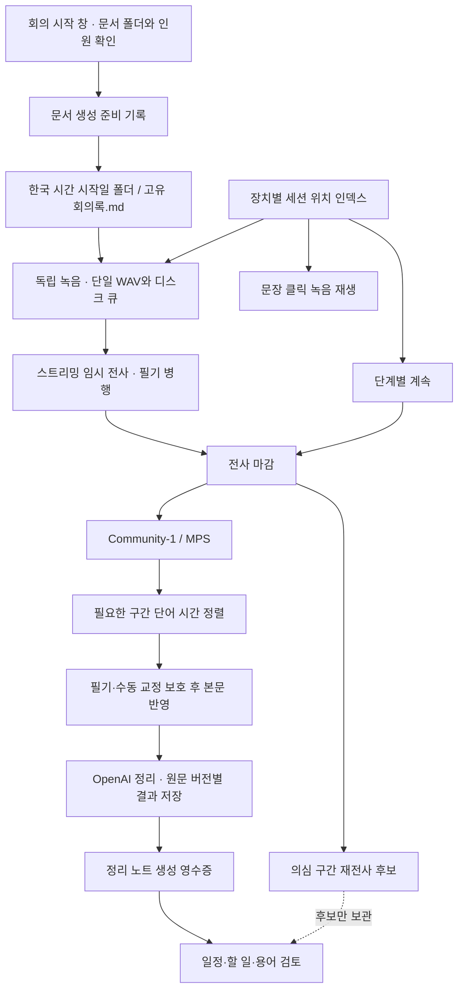

# 저장 연결과 단계별 이어서 처리

적용 버전: 0.13.0-beta.6 · 2026-11-04

## 사용 방법

설정의 **회의록 기본 폴더** 또는 녹음 시작 창에서 Vault 내부 폴더를 지정한다. 예를 들어 `06-기록/회의록/직장`을 선택하면 한국 시간으로 시작한 날짜 아래 `2026-11-04/회의록.md`를 만든다. 같은 날 여러 회의를 시작하면 `회의록 2.md`, `회의록 3.md` 순서다. 회의 중 자정이 지나도 시작 날짜를 유지한다. 시작 창을 취소하면 문서나 녹음을 만들지 않는다.

WAV 저장 폴더는 문서 폴더와 별개다. 설정의 오디오 저장 폴더에는 새 회의의 외부 세션 폴더가 만들어진다. 기본 오디오 폴더를 변경해도 과거 회의는 원래 세션 위치를 계속 사용하며, 사전·음성 프로필·반복 오인식 후보의 공통 저장소도 이전 위치를 유지한다.

명령 팔레트의 **회의 처리 단계와 이어서 처리** 또는 상세 보기의 **처리 상태 · 이어서 처리**에서 단계별 결과와 실패를 확인한다. 실패하거나 중단된 단계는 **이 단계부터 계속**으로 다시 실행한다. 이미 검증된 로컬 결과는 재사용한다. 재전사 후보 단계는 별도로 실행할 수 있으며, 후보 생성만으로 사용자의 교정을 대체하지 않는다.

과거 세션 폴더를 직접 옮겼다면 **회의 저장 위치 연결**에서 해당 회의를 펼치고 이동한 세션 폴더의 절대 경로를 지정한다. 세션 ID, 교정 메타데이터, 완료된 WAV의 실제 내용이 일치해야 연결된다. 파일명이 같아도 다른 녹음이나 오래된 교정 복사본이면 기존 연결을 유지하고 오류를 표시한다. 이전 기본 오디오 폴더도 이 화면에서 검색할 수 있다. 같은 ID의 다른 복사본은 충돌로 표시하며 자동으로 교체하지 않는다.

## 작동 구조



상태와 모델 산출물은 분리한다. 앱은 세션의 `postprocess-v1.json`에 상태와 문서 반영 영수증을 저장하고, Python은 입력별 결과 폴더를 작성한다.

```text
Vault/
  <회의록 기본 폴더>/YYYY-MM-DD/회의록.md
  <정리 폴더 또는 같은 날짜 폴더>/회의록 - 회의 정리.md

<외부 오디오 기본 폴더>/<회의 ID>/
  recording.wav                     # 회의 전체 원음
  queue.sqlite · queue/*.pcm        # 전사와 복구 자료
  meeting.json · transcript.json
  note-preparation.json             # 새 문서 생성 의도와 결과
  postprocess-v1.json (+ .bak)       # 앱 단계 상태와 문서 생성 영수증
  postprocess/artifacts/
    <단계>/<입력 지문>/<시도 ID>/
      result.json                   # 해당 시도의 불변 결과
      <단계별 산출물>
    <단계>/<입력 지문>/latest.json  # 결과와 부속 파일 해시

~/Library/Application Support/obsidian-local-meeting/
  vaults/<Vault ID>/registry.json (+ .bak)
  vaults/<Vault ID>/summary-audio.json
```

기존 `storage` 설정은 새 회의의 오디오 기본 폴더로 유지한다. 새 `qualityStorage`는 최초 전환 때 기존 저장소로 고정하며, `vaultId`는 위치 인덱스의 식별자다. 인덱스는 로컬에만 두며 노트에 절대 경로나 제어용 문법을 삽입하지 않는다. 기존 세션의 `meeting.json`을 읽기만 하여 인덱스를 만들고, 회의 자체를 이동·일괄 재처리하지 않는다.

## 단계별 재사용과 보호

| 단계 | 재사용 기준과 재시도 동작 |
|---|---|
| 전사 마감 | 완료 큐, 안정된 전사, 끝까지 처리한 커서, WAV 범위와 내보낸 전사 일치를 확인. 완료 세션은 STT 모델을 로드하지 않고 저장된 발언을 전달 |
| 재전사 후보 | 원음·전사·후보 구간·사전·모델 가중치·처리 코드 지문을 검사. 일부 완료 시 기존 후보를 복사하고 남은 구간만 재실행 |
| 화자 분석 | 원음·모델 파일·인원 설정·프로필 설정·관련 처리 코드 지문을 검사. 결과와 부속 음성 특징 해시까지 확인 |
| 시간 정렬 | 원음·전사·화자 시간표·모델·처리 코드 지문 검사. 실패 구간만 다시 정렬하고 성공 구간 유지 |
| 본문 반영 | 기존 앵커·수동 잠금·삭제 의도·변경 영수증 경로 사용. 같은 화자 분석에 정렬만 개선되면 별도 적용 버전으로 처리하고 기존 음성 그룹 ID 유지 |
| AI 정리 | 입력 내용·화자 이름·필기 시점 등을 반영한 sourceHash와 모델별 저장 결과 검사. 유효한 저장 결과가 있으면 로그인·네트워크 없이 문서 생성 재시도 |
| 정리 노트 생성 | 생성 전 의도와 본문 해시, 생성 후 영수증 기록. 생성 직후 중단되면 같은 문서를 확인해 채택. 이미 수정된 확정 문서는 유지. 소유 여부가 불명확한 다른 내용은 보류 |

모든 모델 산출물은 새 시도 폴더에 기록한다. 기존 루트의 화자·정렬·재전사 파일은 덮어쓰지 않는다. 완료 WAV의 연결 검증은 **표준 PCM16·16kHz·모노 형식 검사와 파일 전체 SHA-256**을 사용한다. PCM이 같아도 헤더가 달라진 파일은 보수적으로 다른 파일로 취급한다. 정상 완료 세션 재시도에서는 WAV 헤더도 바꾸지 않는다. 미완료 큐 복구가 필요한 경우에만 헤더 수정 전 원본 WAV 백업을 남긴다.

앱의 문서 반영 잠금, Python 실행기 잠금, 모델 후처리 잠금은 같은 회의의 중복 실행을 막는다. 종료되지 않은 프로세스의 잠금은 가로채지 않으며, 존재하지 않는 프로세스가 남긴 잠금만 회수한다. 상태 인덱스는 원자적 교체와 이전 파일 백업을 사용한다.

사용자가 수정한 대사·화자·삭제는 기존 보호 경로를 유지한다. 재시도는 이미 검토한 일정·할 일·사전 항목을 자동 승인하거나 등록하지 않는다. AI 응답이 서버에서 끝났지만 로컬 저장 전에 연결이 끊긴 경우는 저장 결과가 없으므로 재요청할 수 있다. 원격 호출을 정확히 한 번만 보장한다는 의미는 아니다.

## 중단과 예외

- 새 문서 생성 중 중단되면 **미완료 회의록 준비 확인**에서 문서를 열어 보고, 준비 기록을 보관한 뒤 새 회의를 시작한다. 애매한 파일을 자동으로 이어 쓰거나 삭제하지 않는다.
- 옮긴 폴더의 교정 메타데이터가 다르면 자동 병합하지 않는다. 최신 세션 자료를 확인해야 한다.
- 인덱스는 재생과 명시적인 재처리 위치 연결을 제공한다. 모든 과거 회의를 선택해 편집하는 별도의 라이브러리 화면까지 추가한 것은 아니다.
- 반영 중 사람이 내용을 바꾸어 소유권을 판정할 수 없으면 보류한다. 중복 생성이나 덮어쓰기보다 기존 내용 보존을 우선한다.
- 검증은 로컬 캐시와 문서 생성 실패 복구를 포함한다. 실제 유료 AI 재요청과 iCloud 일정 등록은 이번 시험에서 실행하지 않았다.

## 검증 결과

자동 검사 217개가 통과했다. 실제 회의 음성 24초의 분리한 복사본을 소리 없이 공급하여 전사·재전사 후보·화자 분석·시간 정렬과 완료 결과 재사용을 확인했다. 재시도 전후 WAV·전사·큐 DB·설정의 SHA-256이 같았다. Obsidian에서는 새 회의 시작 창과 폴더 범위 검사, 취소 시 미생성, 기존 회의 위치 목록, 처리 상태 화면을 확인했다. 장시간 지연 분포나 화자 정확도 향상률은 이번 검증에서 측정하지 않았다.
