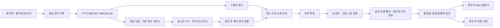

# 회의록 UI/UX 개편과 날짜별 저장

버전: 0.15.0-beta.1 · 2026-11-13

## 새 회의의 저장 규칙

설정 → Local Meeting → 저장 위치 → **회의록 기본 폴더**에서 지정한다. 현재 경로 바로 아래 폴더만 표시하며 클릭으로 내려가고 Tab으로 접두사를 완성한다. 새 경로도 입력할 수 있다.

회의 시작 시 한국 시간(Asia/Seoul)의 날짜를 기준으로 다음 구조를 만든다.

```text
선택한 회의록 폴더/
  2026-11-13/
    11-13.md
    11-13 - 회의 정리.md
    11-13 2.md
    11-13 2 - 회의 정리.md
```

같은 날의 회의는 날짜 폴더를 함께 쓰고 파일명에 번호를 붙인다. AI 정리와 검토본은 각 원문 파일명을 따라 같은 날짜 폴더에 저장한다. 녹음 WAV·큐·DB·프로필의 위치는 기존 설정을 따른다. 시작 뒤 날짜가 바뀌어도 폴더를 옮기지 않는다. 이미 만들어진 회의의 경로·파일명·본문은 일괄 변경하지 않는다.

새 문서의 맨 위에는 다음과 같은 정보가 표시된다. 아래 시각과 인원은 예시다.

```markdown
# 11-13 회의록

시작: 2026-11-13 09:00:00 (Asia/Seoul · UTC+09:00)

참여 인원 설정: 4명 (최대)

녹음 방식: 마이크 + 시스템 오디오

## 필기
```

인원 미지정은 자동 추정, 고정 모드는 고정 인원으로 표시한다. 시작 창을 취소하면 문서·폴더·녹음을 만들지 않는다. 생성 전 경로와 옵션을 준비 기록에 저장해 응답 유실 시 다른 문서를 중복 생성하지 않는다.

## 화면 구성

| 화면 | 일상 작업 | 접거나 분리한 항목 |
|---|---|---|
| 상세 보기 · 회의 | 시작·중지, 시간 표시, 처리 단계, AI 정리, 원문 열기, 녹음 파일 보기 | 참여자·검토·도구를 다른 탭으로 분리 |
| 상세 보기 · 참여자 | 이름 저장, 참여자 추가, 삭제·합치기·연결, 최근 발언별 화자 지정 | 그룹 복구는 참여자 영역 하단 |
| 상세 보기 · 검토 | 필기 시점, 발언 교정, 미확정 그룹 번호 확인 | 매번 녹음 버튼 아래에 나열하지 않음 |
| 상세 보기 · 도구 | 캘린더, 할 일, 사전, 음성 프로필 | 장치 진단·복구·단축키 접기 |
| 설정 | 저장 위치 / 전사 / AI 정리 / 문제 해결 | 실행환경·이전 형식 경로·과거 세션 연결은 문제 해결 |
| 새 회의 | 문서 폴더, 최대 발언 인원, 녹음 소리 | 화자 수 모드·시험 실시간 화자·프로필 수집 접기 |
| 회의 정리 | 노트 열기, 다시 정리, 결정·할 일·일정·미결·용어 탭 | AI 스킬·계정·모델·이전 노트 표시 변환은 접힌 AI 설정 |

상세 보기가 보이면 오버레이를 숨겨 시작 버튼과 겹치지 않게 한다. 최소화하면 오버레이가 다시 나타난다. 기존 드래그 위치와 단축키를 유지한다. 탭은 클릭과 좌우 방향키, Home/End로 이동한다. 탭 사이를 오가도 현재 검토 입력을 유지하며 저장·확인 버튼을 눌러야 반영된다. 창을 닫는 것은 검토 내용의 저장 동작이 아니다.

실시간 전사는 기존 CodeMirror 하단 패널을 유지한다. 본문 길이와 별개인 고정 높이의 세로 스크롤 영역이며, 지난 내용을 읽는 중에는 새 전사 때문에 읽던 위치를 끌어내리지 않는다. 사용자 필기와 화자·본문 교정은 기존 보호 경로를 따른다.

## 버튼과 오류 처리

화자 이름 저장은 저장 완료 후에만 성공을 알린다. 저장 중 중복 입력을 막고 실패하면 원래 수동 데이터를 보존하며 재시도할 수 있다. 편집기 준비 실패를 저장 성공으로 취급하지 않는다. 참여자 삭제·합치기는 대상 선택 전 비활성화하며 명시적인 취소와 오류 표시를 제공한다. 참여자 추가와 할 일 작성에도 취소 버튼을 제공한다. 음성 프로필 불러오기 실패에는 다시 불러오기 버튼을 제공한다.

사전 후보의 중복 연결·즉시 저장 상태·오류 유지와 사전 context 복창 방지는 직전 개발판의 수정 사항을 유지한다. AI 스킬은 기존 네 개의 고정 지침이며, 이번 UI 설계용 Astryx/Taste를 회의 텍스트 전송 프롬프트에 추가하지 않는다.

## 적용한 디자인 스킬

[Meta Astryx](https://github.com/meta/astryx)의 Core/CLI/Neutral 0.7.15와 React 19를 사용해 세 화면의 탐색(상세 보기·설정·AI 검토)을 구성했다. 기존 Obsidian 제어와 편집기는 보존하는 단계적 적용이다. CSS reset과 테마는 플러그인 탐색 영역으로 제한하며 호스트의 색과 폰트를 따른다. 폰트 파일이나 외부 폰트 요청은 추가하지 않는다.

[Taste](https://github.com/Leonxlnx/taste-skill)는 정보 위계·간격·상태 피드백·명확한 동작명·키보드 접근을 검토하는 데 적용했다. 설치된 2.5.1의 웹사이트 영웅 영역·사진·셰이더·웹사이트 gate는 네이티브 Obsidian 도구에 실행하지 않았으며 gate 통과를 주장하지 않는다.

## 구조



검증 범위와 각 버튼군의 확인 방법은 [검증 기록](ux-overhaul/VERIFICATION.ko.md)을 따른다. 정식 릴리즈는 별도로 발행하지 않은 개발판이다.
