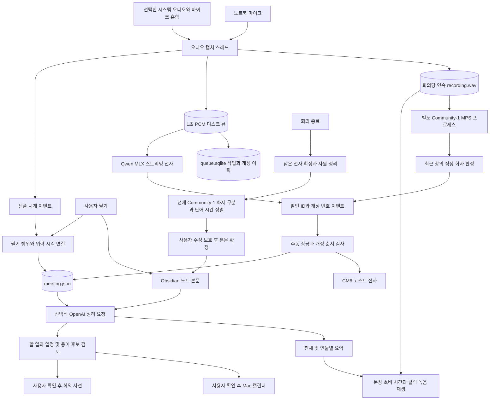
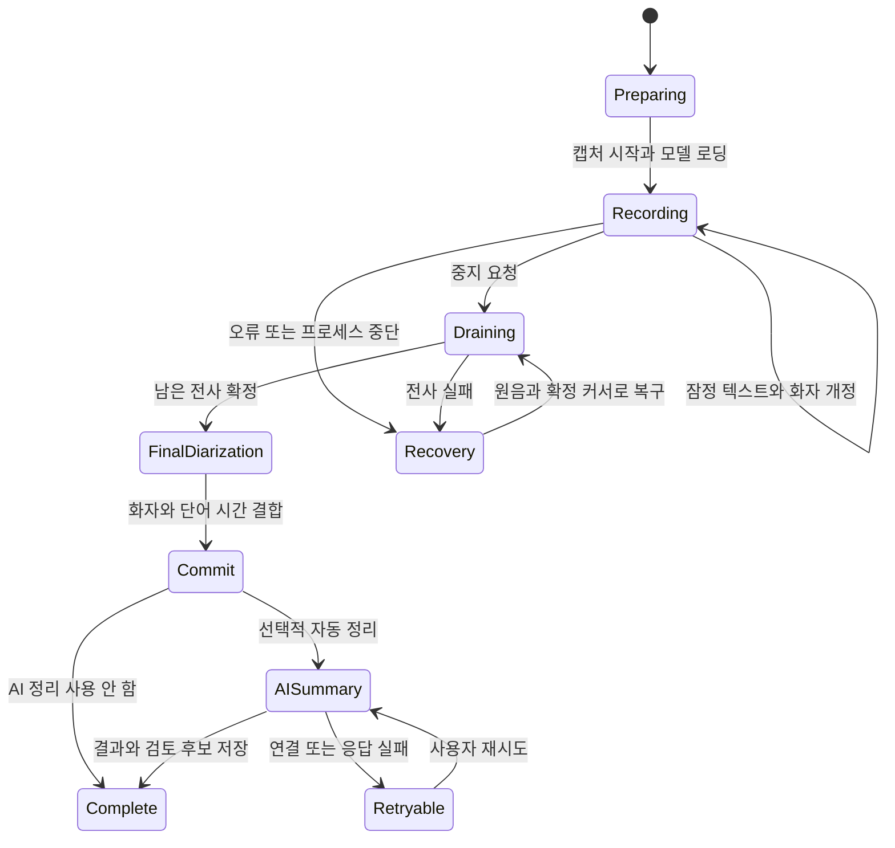
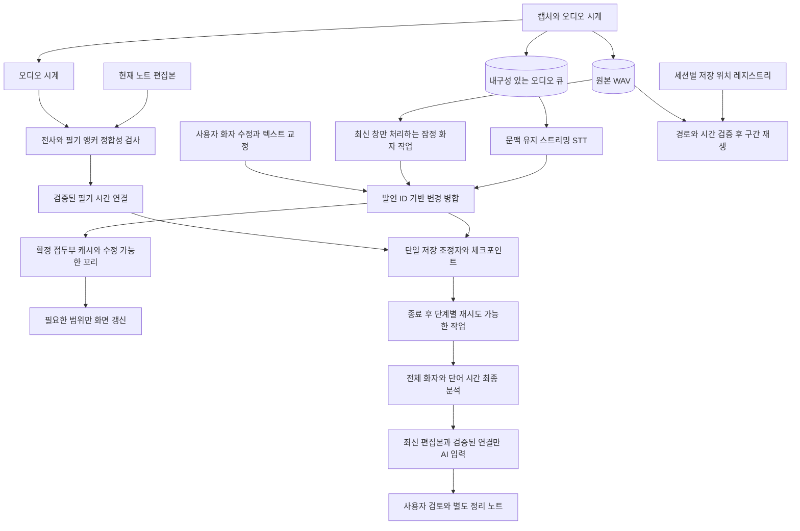

# 현재 설계 도식과 개선 점검 — 2026-11-03

후속 업데이트: 이 문서는 beta.4의 점검 이력입니다. 발견한 P1의 beta.5 수정 결과와 검증은 [P1 안정화 안내](../P1-STABILIZATION.ko.md)를 참고하세요. F06은 후속 과제로 남았습니다.

대상: `0.13.0-beta.4`, 기준 커밋 `5a4f7a6`, Apple Silicon Mac의 현재 로컬 환경. 이 문서는 현재 구현과 개선 제안을 구분한다. 앱 기능 수정·기존 회의 재처리·원본 변경·새 API 호출·음성 재생은 수행하지 않았다.

## 1. 판단

녹음, 스트리밍 전사, 비동기 화자 판정, 종료 후 정리를 분리하는 방향은 유지한다. 새 모델이나 새 기능을 추가하기 전에 **교정 보존, 필기 범위 정합성, 오류 종료, 화자 슬롯, 장시간 UI 성능**을 우선 보강해야 한다. 합성 입력·오류 주입에서 확인한 문제 7개를 아래에 정리했다. P0에 해당하는 원본 녹음 유실은 이번 점검에서 재현하지 않았다. 이는 유실 가능성이 없다는 보증이 아니다.

현재 자동 검사 190개(TypeScript 127, Python 63)는 모두 통과했다. 그와 별도로 작성한 관찰 스크립트에서 아래 경계 사례가 발견됐다. 기존 검사는 일부 보호 정책을 확인하지만 그 정책이 진행 중인 문장에 미치는 부작용까지 검증하지 않는다.

## 2. 현재 구현 도식



### 실제 동작에서 주의할 점

- STT는 화자 분석 결과를 기다리지 않는다. 다만 화자 분석 요청·결과 반영을 조율하는 부분은 전사 부모 프로세스의 루프에도 있으므로 모든 단계가 완전히 독립적인 서비스는 아니다.
- 실시간 화자는 최대 24초 창을 4초 간격으로 분석한다. `relabel_recent`의 최근 5초 보류는 후속 재배정에 적용된다. 최초 STT 이벤트는 이미 도착한 turns로 바로 귀속하므로 모든 화면 표시가 반드시 5초 안정화를 거치는 것은 아니다.
- 실시간 스트리밍 문장은 말끝/최대 길이 기준이다. 문장 내부의 화자 교대는 즉시 단어별로 쪼개지 않으며 종료 후 정렬로 보완한다. 따라서 잠정 화자 기능과 실시간 음원 분리·단어별 완전 귀속을 같은 기능으로 보면 안 된다.
- 필기 본문은 실제 Markdown이고 전사는 회의 중 CM6 위젯이다. 최종 확정 때 전사가 본문에 추가된다. 필기와 전사를 시간 순으로 자동 재배열하는 기능은 없다.

## 3. 현재 상태와 저장 책임



이 상태도는 정상 경로와 복구 의도를 표현한다. 현재는 단일 상태 enum 대신 `bridge`, `closing`, `summaryBusy`, `presentation`, 문자열 `state`를 조합해 표현하므로 유효하지 않은 조합을 타입으로 막지 못한다. F01의 오류 정리 경로는 의도한 복구 체크포인트를 보장하지 못한다.

| 데이터 | 현재 위치/역할 | 유지할 원칙 |
|---|---|---|
| 연속 WAV | 세션 폴더 `recording.wav` | 원본 음성의 기준, 앱 오류와 독립적으로 보호 |
| PCM 큐 | `queue/audio-*.pcm` | 처리·복구용 파생 데이터, WAV와 중복 저장 |
| 작업·개정 | `queue.sqlite` | 발언 ID, 개정, 확정 커서, ACK |
| 앱 메타데이터 | `meeting.json` | 수동 화자/텍스트 잠금, 필기 시각, 노트 연결 |
| 필기·확정 전사 | Vault Markdown | 사용자의 편집본 우선 |
| AI 결과/검토 | `ai-summary-*.json` 및 검토 상태 | 원문과 별도, 중복 반영 방지 |
| 요약 재생 인덱스 | 저장 루트 아래 품질 폴더 | 현재는 노트 경로→세션 ID, 원래 저장 위치 부족 |

## 4. 재현한 문제와 우선순위

### F01 · P1 · 캡처 오류의 정리 과정에서 후속 체크포인트 저장이 생략됨

**위치:** `worker/text_worker.py:149–154`.

`finally`에서 `cap.stop()`이 먼저 실행된다. 이것이 예외를 던지면 이후 `live.close`, 미반영 큐 등록, `revisions.export`, 메트릭, DB 닫기를 건너뛴다. 실제 Capture.stop도 오디오 오류가 기록돼 있으면 예외를 던진다. 오류 주입 결과 원래 오류 대신 정리 오류가 보고됐고 `transcript.json`과 `metrics.json`이 생성되지 않았다.

**영향:** 오류가 발생했을 때 오히려 복구 자료·진단이 덜 남는다. 이 재현은 원본 WAV 유실을 증명하지 않는다.

**수정안:** 캡처 정지, 화자 프로세스 정리, 큐 드레인, DB/전사 체크포인트를 각각 독립된 try/finally로 실행한다. 최초 오류와 정리 오류를 함께 보존한다.

**통과 조건:** 캡처 정지 실패를 주입해도 나머지 정리 시도와 체크포인트 저장이 확인되고, 기존 원음은 유지된다.

### F02 · P1 · 진행 중인 전사 교정이 이후 발언까지 잠금

**위치:** `src/quality-model.ts:12`, `:20–26`; 잠정 발언도 편집 가능한 `src/quality-ui.ts`.

진행 중인 `u_0`의 일부를 고치면 발언 전체가 textLocked가 된다. 같은 ID의 최종 전사에 뒤에 이어진 말이 추가돼도 이전 교정 문자열만 유지한다. 재현: 1초 시점의 교정 텍스트 → 5초까지 늘어난 최종 전사 → 화면 텍스트는 교정 부분만 남고 구간 종료 시각은 5초로 늘어난다.

**영향:** 원음은 남아도 노트·요약에서 후속 발언이 빠질 수 있다. 이전 안내에 적었던 제한이며, 사용자에게 제약을 맡기기보다 구조를 수정해야 한다.

**수정안:** 단기적으로 잠정 발언의 텍스트 교정과 화자 이름 수정을 분리한다. 텍스트 교정은 확정 뒤 허용하거나, 사용자가 교정한 확정 접두부와 이후 자동 꼬리를 별도 ID/범위로 관리한다. 최근 모델 재작성과 교정이 충돌하면 자동 추측 없이 원문 후보를 함께 보여준다.

**통과 조건:** 교정한 내용이 보존되면서 이후 새 발언도 별도로 남는다. 화자만 수정했을 때 텍스트 전체가 잠기지 않는다.

### F03 · P1 · 외부/닫힌 노트 수정 후 필기 시간 연결이 다른 내용을 가리킬 수 있음

**위치:** `src/note-timing.ts`의 `timedNotes`, `src/ai-summary.ts`의 `summaryInput`; `src/main.ts`의 `currentInput/openTimedNotes`.

편집 이벤트에서는 범위를 옮기지만, `timedNotes`는 전달받은 최신 문서가 저장된 `noteTimingSnapshot`과 같은지 검사하지 않고 좌표로 자른다. 닫힌 노트를 외부 편집/동기화한 뒤 이 경로로 읽으면 재연결이 누락될 수 있다. 재현: 기존 `메모`의 0–2 위치를 저장 → 앞에 `추가 내용`을 삽입한 문서를 전달 → 연결 텍스트가 `메모` 대신 `추가`가 됨.

**영향:** 필기 검토와 AI 문맥에 잘못된 시간 연결을 공급할 수 있다. 실제 외부 동기화 앱의 모든 이벤트 경로를 시험한 것은 아니며, 읽기 함수의 경계 사례를 재현했다.

**수정안:** 문서 읽기 진입점을 통합하고, 필기/전사 앵커를 같은 최신 스냅샷에 재연결한다. 모호한 변경은 원문 검토 대상으로 표시하고 잘못된 시간 연결은 AI에 넣지 않는다.

**통과 조건:** 열린 편집기·닫힌 파일·외부 동기화·복구 경로 모두 동일한 필기 내용을 가리킨다.

### F04 · P1 · 잘못 생성된 잠정 화자가 최대 인원 슬롯을 계속 점유

**위치:** `worker/live_speakers.py:5–29`의 `OnlineLabels`.

최대 인원이 `next_id`의 누적 발급 횟수에도 적용된다. 수명이 끝난/잘못 생성된 후보를 병합하거나 회수하는 정책은 없다. 재현: 최대 2명에서 초반 두 후보가 live_1/2를 받음 → 이후 다른 특징 벡터가 등장 → 새 후보는 unknown. 이후에도 새 슬롯은 생기지 않는다.

**영향:** 초반 오분류가 있었을 때 뒤늦은 실제 참여자에게 새 번호를 줄 수 없다. 실제 오분류 빈도나 오늘 녹음의 인물 정답을 측정한 결과는 아니다.

**수정안:** 잠정 군집 ID 수와 최종 인물 상한을 분리한다. 미확정 후보는 보류 풀에 유지하고 시간에 따라 병합/재평가한다. 번호 회수 시 기존 사람에게 번호를 재사용해 혼동시키지 말고 별칭·병합 이력으로 추적한다. 초과를 기존 화자로 강제 배정해서는 안 된다.

**통과 조건:** 초반 오군집 뒤 늦게 말한 사람도 후보로 남고, 수동 이름이 다른 사람에게 재사용되지 않는다.

### F05 · P1 · 전사 전체 미리보기를 매번 재구성하는 비용이 큼

**위치:** `src/live-preview.ts:6–8`, `src/editor-changes.ts`, `src/main.ts:358–373`.

매 개정에서 회의를 structuredClone하고, 전체 발언을 가상 문서로 다시 만든다. 내부 반복 검색·문자열 차분·앵커 이동이 겹쳐 테스트 크기에서 비용이 비선형적으로 증가했다.

| 합성 발언 수 | 4회 함수 실행 관측 |
|---:|---:|
| 100 | 약 1.0–3.5ms |
| 1,000 | 약 88–93ms |
| 3,000 | 약 823–842ms |

같은 Mac에서 `previewText`만 실행한 값이다. 실제 Obsidian 전체 프레임 지연이나 장시간 p95 측정은 아니다. 그러나 UI 스레드에서 약 0.8초의 동기 작업이 가능한 경로라는 점은 확인됐다. 전체 메타데이터 저장과 실제 DOM 작업은 이 수치에 포함되지 않는다.

**수정안:** 확정된 앞부분은 캐시하고 최근 수정되는 발언만 갱신한다. 발언 ID→위치 인덱스를 유지하고 미리보기용으로 전체 문서 패치 엔진을 재사용하지 않는다. UI 갱신을 최신 개정으로 합치고 저장은 체크포인트 단위로 묶되 원음/확정 커서의 내구성은 유지한다.

**통과 조건:** 3,000발언에서 한 발언의 꼬리/이름 변경이 전체 문서 크기만큼 재처리되지 않는다. 실제 Obsidian에서 긴 회의 필기 지연과 메모리도 측정한다.

### F06 · P2 · 저장 루트 변경/노트 이동 후 과거 녹음 연결 취약

**위치:** `src/summary-playback.ts:8–15`, `src/summary-audio-ui.ts:35`, `src/main.ts`의 `root/openRecordingFolder`.

재생 경로는 세션의 원래 directory가 아니라 현재 설정 root + 세션 ID로 계산한다. 루트 변경 시 기존 파일을 옮기지 않았어도 새 위치에서 찾는다. 재생 인덱스도 노트 경로 기준이며 rename/move 연동이 보이지 않는다. 경로 계산 재현으로 새 루트가 사용됨을 확인했으며, 실제 사용자 저장 폴더를 옮기지는 않았다.

**수정안:** 세션 레지스트리에 원래 저장 위치를 유지하고 경로 검증 후 읽는다. 새 회의 기본 저장 위치와 기존 세션 위치를 분리한다. 노트 rename/move 이벤트로 인덱스를 갱신하고, 인덱스 재구축 수단을 둔다.

**통과 조건:** 기본 저장 위치 변경·노트 이동·앱 재시작 뒤에도 과거 문장의 재생 위치가 유지된다.

### F07 · P2 · 종료 후에도 실시간 검토 사유가 남음

**위치:** `src/speaker-refinement.ts:52`, `src/quality-model.ts:3`.

완료된 단일 화자 발언에도 `실시간 잠정 화자 · 종료 후 재분석` 사유가 남아 needsReview가 true다. 성공한 종료 후 분석으로 single 상태가 된 합성 발언에서 재현했다.

**수정안:** 상태 안내와 실제 검토 사유를 구분하고, 분석 단계가 끝나면 해당 단계의 일시적 사유를 제거한다. 실제 겹침·충돌·근거 부족만 검토 대상으로 둔다.

**통과 조건:** 확실한 최종 발언은 재검토 수를 올리지 않고, 실제 충돌 사유는 보존된다.

## 5. 줄이거나 정리할 기능·구현

| 항목 | 판단 | 권장 조치 |
|---|---|---|
| 연속 WAV + 디스크 큐 + 개정 번호 | 필수 | 유지. 일반적인 인메모리 큐로 단순화하지 않음 |
| 고스트 전사와 실제 필기 분리 | 필수 | 유지. 가상 전사 전체 재생성만 제거 |
| 종료 후 전체 화자/단어 정렬 | 필수 | 실시간 오분류 복구를 위해 유지 |
| 매 개정에 전체 회의 JSON/미리보기 처리 | 과한 구현 | 최근 범위 변경과 묶음 저장으로 축소 |
| 예전 Activity/hysteresis/phrase_end 유틸 | 실행 경로에서 빠진 코드 후보 | 현재 production 참조는 발견하지 못했고 테스트에서 참조됨. 별도 보관/삭제 전 실제 복구 호환성 확인. 남아 있는 Nemotron 실행 모델이라는 뜻은 아님 |
| Store.claim/peek/fail/results 등 과거 큐 API | 중복 API 후보 | 현재 워커는 rows/complete와 확정 커서를 사용. 구형 데이터 읽기 호환은 보존하고 사용하지 않는 쓰기 API·테스트를 정리 |
| 반복적인 시작/중지/확정/검토 진입점 | 사용자 선택이 과다 | 평상시 오버레이는 시작/중지·상세·캘린더 중심. 수동 확정·복구·번호 적용은 고급 메뉴로 이동 |
| 고정 인원 모드 | 잘못 쓰기 쉬움 | 기본은 최대 인원. 고정값은 고급 설정으로 유지 |
| 음성 프로필 자동 배정 | 선택적·검증 부담 큼 | 기능은 유지하되 확인된 표본만 수집. 검증 전 기본 자동 배정 확대/상시 실시간 대조는 보류 |
| 사전의 개인/Vault/프로젝트/회의 범위 | 활용도 대비 복잡 | 기본 UI는 현재 프로젝트와 이번 회의만 노출. 기존 범위 데이터는 삭제하지 않음 |
| 요약·할 일·일정·용어를 한 요청으로 추출 | 효율적 | 유지. 각 기능마다 별도 실시간 API를 추가하지 않음 |
| PCM 파생 파일 영구 누적 | 저장 비용 과다 가능 | 성공 종료와 WAV 무결성 확인 뒤 선택적 정리 정책 검토. 이번에는 삭제하지 않음 |
| 과거 설계 문서의 현재형 표현 | 혼동 유발 | 현재 구조 문서 하나를 기준으로 하고 예전 계획/상태는 이력으로 표시 |

16kHz/mono/PCM16 한 시간은 약 115.2MB(약 109.9MiB)다. WAV와 PCM 큐를 모두 보존하면 오디오만 약 230.4MB/시간이며 DB·개정·백업은 별도다. 이 계산은 메모리 사용량이 아니다.

등록 명령은 현재 21개다. 명령이 많다는 사실만으로 삭제할 필요는 없지만, 기본 화면에는 회의 중 필요한 작업만 두고 나머지는 상세/복구로 모을 필요가 있다.

## 6. 권장 구조 — 아직 미구현



전사·화자·필기 상태를 작은 typed reducer와 저장 조정자로 모으되 범용 워크플로 프레임워크를 새로 도입하지 않는다. 캘린더·사전·프로필은 이 핵심 파이프라인의 선택적 어댑터로 유지한다.

## 7. 권장 개선 순서와 검증 기준

1. **1차 안정화:** F01 오류 정리, F02 교정/후속 말 분리, F03 필기 범위 재연결. 사용자 자료의 의미와 복구를 우선한다.
2. **2차 회의 품질:** F04 잠정 군집과 인물 상한 분리, F07 검토 사유 정리. 실시간 이름 변경은 수정 가능한 잠정 결과로 유지한다.
3. **3차 장시간 성능:** F05 증분 렌더링·저장 조정. 30–60분 실시간 공급에서 텍스트 지연 p50/p95, UI 입력 지연, 양 프로세스 RSS/통합 GPU 메모리, 디스크 증가를 함께 측정한다.
4. **4차 운영 정리:** F06 세션 레지스트리, 파일 이동, 선택적 파생 파일 정리, 고급 메뉴와 과거 코드·문서 정리.

전사 정확도와 화자 정확도는 별도 정답 자료로 평가해야 한다. 이번의 함수 재현·속도 시험을 CER/DER 개선 수치로 사용하지 않는다. 실제 7명 회의의 끼어들기 정답, 장시간 실제 UI 입력, 권한 철회·디스크 부족·갑작스런 강제 종료·실제 노트 rename/move 경로는 추가 검증 대상으로 남긴다.

## 8. 재현 자료

저장소 루트에서 다음을 실행한다. 합성 자료와 임시 폴더만 사용하며 모델 추론·마이크·소리 재생·API는 사용하지 않는다.

```sh
npm run check
npx tsx docs/audits/reproduce-beta4.ts
.venv/bin/python docs/audits/reproduce-beta4.py
```

`reproduce-beta4.*`는 결함 경로를 관찰하는 진단 스크립트이며 정답 성능 평가나 제품 회귀 테스트가 아니다. 출력은 `beta4-typescript-observations.jsonl`, `beta4-python-observations.jsonl`에 보관했다. 후속 수정 시 같은 사례를 기대 결과가 명확한 회귀 테스트로 옮긴다.
